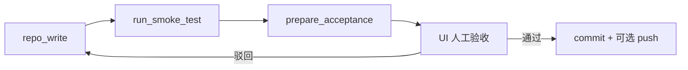

# meostock AI Agent

> 本机投研与工程副驾驶：看板一级入口 + 工具循环运行时。  
> 开发计划：[`dev-plan-ai-agent.md`](./dev-plan-ai-agent.md)  
> 状态：**Phase 0–3 已落地**（查库 + 工作区 coding + 自升级验收提交）

---

## 1. 定位

| 项 | 说明 |
|----|------|
| 入口 | 看板侧栏「AI Agent」→ `/dashboard/agent` |
| 模型 | 复用设置页「当前生效」AI 档案 |
| 与 K 线 AI | K 线页仍为「单标的助手」；本页为「全局任务台」 |
| 权限默认 | `workspace_and_repo` **全权限 L2**（每轮对话均开放完整工具集） |

硬边界：

- 数据库**只读**
- 禁止写 `.env` / `*.db` / `.git` / `node_modules` 等
- 自升级 **commit/push 必须人工验收**（UI 按钮）
- 不提供实盘下单
- 前端发布：`./scripts/build_dashboard.sh`（项目内 shell，Agent 可直接执行）

---

## 2. 权限分级

| 级别 | 范围 | 状态 |
|------|------|------|
| L0 只读 | DB SELECT、schema、标的搜索 | 工具仍在，但默认不再降级到仅 L0 |
| L1 工作区写 | `data/agent_workspaces/<session>/` + 项目内 shell | 已并入默认 L2 |
| L2 本仓库写 | meostock 树（受保护路径除外）+ smoke + 验收 + 前端构建 | **默认** |
| L3 项目内 shell | 仓库/工作区 cwd 全开；禁 commit/push/sudo | 已落地 |
| L4 本机会话授权 | 更广路径（家目录任意） | 未做 |

---

## 3. 自升级状态机

冒烟脚本：[`scripts/agent_smoke_test.sh`](../scripts/agent_smoke_test.sh)（导入检查 + 可选 live health，不杀 8765 进程）。

---

## 4. HTTP API

| 路径 | 说明 |
|------|------|
| `GET /api/agent/health` | 模型 + phase + 能力 |
| `GET /api/agent/prompts` | 精选提示词 |
| `GET /api/agent/skills` | skill 元数据 |
| `GET /api/agent/projects` | 目标项目列表（meostock 本仓库 + Agent 工作区项目；已隐藏的不返回） |
| `POST /api/agent/projects` | 新建工作区项目（`name` 可空 → 默认名；目录落在 `data/agent_workspaces/`） |
| `DELETE /api/agent/projects/{id}` | 从列表移除（仅 `project.json` 标 `hidden`，**不删**目录文件；本仓库不可删） |
| `POST /api/agent/chat` | 工具循环 SSE（`sessionId` / `projectId` / `skillId`；可选研判 Scope：`scopeType` / `scopeId` / `asOf` / `visibleSignals` / `strategyTemplateId`） |
| — | 工具轮次默认不限制（安全上限 500；可用环境变量 `AGENT_MAX_TOOL_ROUNDS` 调高/调低） |
| `GET /api/agent/fs/tree` | IDE：列目录（`projectId` + `path`） |
| `GET /api/agent/fs/file` | IDE：读文件（支持 `offset` / `max_chars`） |
| `GET /api/agent/git/summary` | IDE：分支 + porcelain 变更列表 |
| `GET /api/agent/git/diff` | IDE：单文件 diff |
| `WS /api/agent/terminal` | IDE：本机 PTY（`cwd`=当前项目根；单用户信任边界） |
| `GET /api/agent/workspace/{sessionId}` | 工作区文件列表（浅） |
| `GET /api/agent/acceptance` | 待处理验收单 |
| `POST /api/agent/acceptance/{id}/approve` | 标记批准 |
| `POST /api/agent/acceptance/{id}/reject` | 驳回 |
| `POST /api/agent/acceptance/{id}/finalize` | 批准后 commit（`push` 默认 true） |

SSE 事件：`start` / `intent` / `tool_*` / `content` / `artifact` / `acceptance` / `entities` / `error` / `done`

### 页面布局（工作台）

`/dashboard/agent`：左会话 · 中央多标签（对话 / 代码 / Diff）· 右侧常驻侧栏（文件 / Git 变更 / 终端 / 产物 / 工具轨迹）。终端为网页 PTY，cwd 锁在当前项目；不替代验收提交流程。代码标签按扩展名做 highlight.js 语法着色（超大文件回退纯文本）。「产物」侧栏只列本会话写入的文件，点击相对路径在中央代码标签打开（按 `projectId` 读内容，不依赖本机绝对路径）；验收操作在「变更」侧栏。

---

## 5. 工具一览

| Tool | 权限 |
|------|------|
| `schema_inspect` / `sql_readonly` / `symbol_search` | L0 |
| `workspace_*` / `shell_run` | L1+ |
| `repo_*`（支持 `start_line`/`offset` 分段读） / `run_smoke_test` / `git_*` / `prepare_acceptance` | L2 |
| `shell_run` | 项目内开放（cwd=repo/workspace）；禁 commit/push/sudo |

---

## 6. 非目标

- L4 整机任意路径
- 无人值守自动 push
- 实盘交易 / 多用户云同步

---

## Agent 自升级演练

本节为最小自升级演示：Phase 2（工作区 coding + 项目内 shell）与 Phase 3（自升级验收闭环）均已可用，Agent 可在受保护路径之外写入仓库并跑冒烟测试。

改动仍需人工在 UI 验收后才 commit/push，Agent 自身不具备 push 权限。

演练链路：`repo_read` 看现状 → `repo_write` 改文档 → `run_smoke_test` 必须通过 → `prepare_acceptance` 出验收单 → UI 人工验收后 commit。
