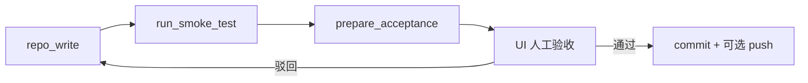

# meostock AI Agent

> 本机投研与工程副驾驶：看板一级入口 + 工具循环运行时。  
> 开发计划：[`dev-plan-ai-agent.md`](./dev-plan-ai-agent.md)  
> 状态：**Phase 0–3 已落地**（查库 + 工作区 coding + 自升级验收提交）

---

## 1. 定位

| 项 | 说明 |
|----|------|
| 入口 | 看板侧栏「AI Agent」→ `/dashboard/agent` |
| 模型 | 复用设置页「当前生效」AI 档案 |
| 与 K 线 AI | K 线页仍为「单标的助手」；本页为「全局任务台」 |
| 权限默认 | `workspace_and_repo` |

硬边界：

- 数据库**只读**
- 禁止写 `.env` / `*.db` / `.git` / `node_modules` 等
- 自升级 **commit/push 必须人工验收**（UI 按钮）
- 不提供实盘下单

---

## 2. 权限分级

| 级别 | 范围 | 状态 |
|------|------|------|
| L0 只读 | DB SELECT、schema、标的搜索 | 已落地 |
| L1 工作区写 | `data/agent_workspaces/<session>/` + shell allowlist | 已落地 |
| L2 本仓库写 | meostock 树（受保护路径除外）+ smoke + 验收 | 已落地 |
| L3 命令 allowlist | 构建脚本、git status/diff、py_compile、smoke | 已落地 |
| L4 本机会话授权 | 更广路径 | 未做 |

---

## 3. 自升级状态机

冒烟脚本：[`scripts/agent_smoke_test.sh`](../scripts/agent_smoke_test.sh)（导入检查 + 可选 live health，不杀 8765 进程）。

---

## 4. HTTP API

| 路径 | 说明 |
|------|------|
| `GET /api/agent/health` | 模型 + phase + 能力 |
| `GET /api/agent/prompts` | 精选提示词 |
| `GET /api/agent/skills` | skill 元数据 |
| `POST /api/agent/chat` | 工具循环 SSE（`sessionId` 绑定工作区） |
| `GET /api/agent/workspace/{sessionId}` | 工作区文件列表 |
| `GET /api/agent/acceptance` | 待处理验收单 |
| `POST /api/agent/acceptance/{id}/approve` | 标记批准 |
| `POST /api/agent/acceptance/{id}/reject` | 驳回 |
| `POST /api/agent/acceptance/{id}/finalize` | 批准后 commit（`push` 默认 true） |

SSE 事件：`start` / `intent` / `tool_*` / `content` / `artifact` / `acceptance` / `entities` / `error` / `done`

---

## 5. 工具一览

| Tool | 权限 |
|------|------|
| `schema_inspect` / `sql_readonly` / `symbol_search` | L0 |
| `workspace_*` / `shell_run` | L1+ |
| `repo_*` / `run_smoke_test` / `git_status` / `git_diff` / `prepare_acceptance` | L2 |

---

## 6. 非目标

- L4 整机任意路径
- 无人值守自动 push
- 实盘交易 / 多用户云同步
