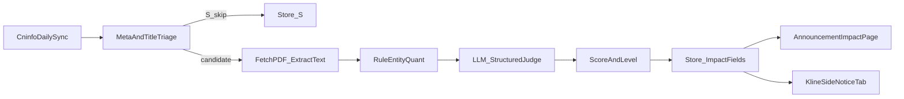

# 全 A 公告异动影响力分析方案

> 目标：解析每天新增的巨潮公告，评估对股价的短周期冲击（1–5 个交易日超额收益与涨跌停概率），打上重要性标签，展示命中原因，并提炼直接影响股价的核心摘要。  
> 核心逻辑：**信息含量 × 预期差**——改变对公司未来现金流、控制权或筹码结构的预期，且往往在披露瞬间集中释放。  
> 范围：全 A 新增公告；展示入口为独立「公告异动」页 + K 线侧栏「公告」增强。  
> 原则：全市场日增量可达数千条，**不能**对每条都下载 PDF + 调 LLM；采用漏斗式流水线。  
> 现状可复用：`web/cninfo/` 元数据同步与 `/api/cninfo/announcements`；`web/ai/` 模型档案；侧栏公告在 `web/static/kline-side.js`。

---

## 0. 目标与约束

| 项 | 约定 |
|----|------|
| 解析范围 | 全 A 每日新增巨潮公告 |
| 输出 | 四级重要性（特大/大/中/小）、方向、可排序 Score、命中原因、核心摘要 |
| UI | 独立「公告异动」页 + 侧栏「公告」增强（两者都要） |
| 成本约束 | 标题/元数据规则全量；PDF + LLM 仅「特大/大」及强中等候选 |
| 不做（一期） | 永久归档全市场 PDF、OCR 主力、盘中可交易性实盘撮合、完整一致预期库 |

**已有能力**

- 巨潮标题 / 时间 / `pdf_url` 同步：`web/cninfo/`
- 夜间/手动任务：`cninfo_announcement_sync`
- AI 配置：`web/ai/config.py` → `active_config()`

**缺口**

- 无 PDF 下载与正文抽取
- 无影响力字段、线索（同一事项）关联、评估任务
- 无 dashboard「公告异动」页；侧栏仅列表 + 打开远程 PDF

**分级演进说明**：早期草案曾用三级（L3/L2/L1）。按短周期涨跌停概率与信息增量，定稿为 **四级：特大 / 大 / 中 / 小**（代码字段 `XL` / `L` / `M` / `S`）。

---

## 1. 影响力分级（产品定义）

| 级别 | 代码 | 短周期含义 | 处理策略 |
|------|------|------------|----------|
| **特大** | `XL` | 易一字板、连续板或跌停；直接改写估值/合规结果 | 必下 PDF + LLM；最高优展示与监控池 |
| **大** | `L` | 常见约 3%–10% 超额，偶有涨停 | 强命中必下 PDF；默认进异动页 |
| **中** | `M` | 有波动、方向常不确定；情绪市可被炒作 | 默认标题分；强力度词才抽 PDF |
| **小** | `S` | 流程性披露，基本无冲击 | 不抽 PDF；可折叠/默认过滤 |

方向：`direction` = `bullish` | `bearish` | `mixed` | `neutral`。

另存可排序分：`score`（0–100+，见 §3.4），阈值建议：

| Score | 级别 |
|-------|------|
| ≥ 75 | 特大 |
| 55–75 | 大 |
| 35–55 | 中 |
| < 35 | 小 / 噪音 |

### 1.1 特大（正向）

| 类型 | 为何影响极大 |
|------|----------------|
| 发行股份购买资产 / 重大资产重组（**首次**预案、草案） | 对标的与业务重估 + 筹码锁定，复牌补涨空间大 |
| 重组上市（借壳）、控制权变更 / 易主 | 整体重估；新实控人常带资产注入预期 |
| 要约收购（尤其溢价） | 明确价格锚与套利空间 |
| 业绩预告/快报大幅超预期（扭亏、净利同比翻倍且远超预期） | 直接修正盈利预测 |
| 重大合同/中标（金额占上年营收 **≥30%**） | 改写未来 2–3 年收入基数 |
| 重大技术突破 / 核心产品获批（创新药获批、三类证、大额海外订单、首台套等「从 0 到 1」） | 打开新增市场空间 |

### 1.2 特大（负向）

| 类型 | 为何影响极大 |
|------|----------------|
| 证监会立案、实控人被留置 | 合规风险与不确定性骤增 |
| 退市风险警示（*ST）、重大违法强制退市 | 指向退市极端结果 |
| 业绩爆雷（预亏、大额商誉减值、计提减值超净资产 10%） | 资产负债表受损 |
| 债务违约、大额违规担保、资金占用、审计非标 | 信用风险暴露 |
| 破产重整 / 清算申请 | 极端负向 |
| 核心产品集采失标或大幅降价、大客户流失 | 商业模式受破坏 |

### 1.3 大（正向 / 负向）

**正向**：定增或引入战投（产业资本/国资/龙头）、股权激励/员工持股（高行权价+高考核更正）、注销式回购或大额上限（占市值 ≥3%）、实控人/董监高大额增持（含承诺不减持）、大额扩产投产、产品涨价函、分拆子公司上市/子公司战投或 IPO 受理。

**负向**：大股东清仓式/顶格减持、董监高集中减持（占流通股 ≥2% 更明显）、重大诉讼仲裁（占净资产 ≥10%）、定增破发、募投终止或变更、核心技术人员或总经理离职。

### 1.4 中

一般对外投资/参股（小额无并表）、战略合作/意向框架（**无金额无约束力时多为噪音，情绪市可炒**）、设子公司/变更经营范围、日常关联交易预计、委托理财、董监高换届、股权质押/解押/展期、限售解禁、未触控制权的小比例转让、澄清公告（方向取决于内容）、投资者关系活动记录（热门赛道+密集调研时有短线效应）。

### 1.5 小（流程性）

已预告过的年报/半年报、季报、股东大会决议、章程/议事规则修订、审计委员会履职、会计政策变更、续聘会计师、程序性董事会决议、募资存放使用、保荐核查意见、**无增量信息的股价异动公告**等。

### 1.6 铁律：首次披露信息价值最高

重组链路示例：`停牌/筹划` → `预案` → `草案` → `问询回复` → `过会` → `注册生效` —— **每往后一步边际信息量递减**。

- **草案修订稿、进展、问询回复** 通常已是二次以上披露，**单独这条的股价弹性远小于首次预案**。
- 识别「哪一条是真 signal」必须依赖：`is_first_disclosure` + `disclosure_stage` + 同一事项线索 ID（见 §3）。
- 「伪信号」词见 §2.5，命中即降权，不得仅因标题含「重组」就打特大。

### 1.7 其他定级原则

- **预期差 > 绝对增速**；扭亏冲击常强于常规预增。
- **规模可升级**：合同默认「大」，占营收 ≥30% 升「特大」；诉讼占净资产 ≥10% 升「大」。
- **市值与情绪**：小市值/热门赛道对同额合同更敏感——`score` 乘市值/板块系数（一期可用流通市值分档近似）。
- **注册制后**：高送转炒作已明显弱化，默认不超过「中/大」，禁止按 2015–2018 规律外推为特大。
- **位置效应**：UI 提示即可；一期不自动反向改分。
- **监控池优先**：重组/控制权/获批类（正）与合规/退市类（负）单独高优先级。

---

## 2. 公告类型与关键词（识别本体）

配置文件：`web/cninfo/impact_taxonomy.json`（规则与 LLM 共用）。

关键词分三层：

| 层 | 作用 | 示例 |
|----|------|------|
| **事件类型** | 粗筛大类 | 重组、收购、立案、扭亏、中标、回购、减持… |
| **方向词** | 利好/利空先验 | 获批/通过/扭亏 vs 立案/逾期/终止/失标 |
| **力度词** | 冲击强度 | 亿元、占比、同比、商誉、净资产、市值 |

### 2.1 正向强信号（特大候选）

`发行股份购买资产`、`发行股份及支付现金购买资产`、`重大资产重组`、`购买资产并募集配套资金`、`重组上市`、`借壳`、`控制权变更`、`实际控制人变更`、`要约收购`、`预盈`、`扭亏为盈`、`业绩预增`、`同比增长超`、`中标`、`重大合同`、`签订.*合同`、`日常经营重大合同`、`获批`、`注册证`、`临床.*批准`、`三类.*证`、`首台套`、`海外订单`、`专利`、`技术突破`、`量产`、`涨价`、`提价`

**重组补充**：`重组报告书`、`置入`、`置出`、`标的资产`、`配套募集资金`、`关联交易报告书`、`评估值`、`溢价率`、`业绩承诺`、`商誉`、`摊薄`

### 2.2 正向中强信号（大候选）

`向特定对象发行`、`非公开发行`、`定向增发`、`引入战略投资者`、`股权激励`、`员工持股`、`回购`、`回购注销`、`注销`、`增持`、`不减持`、`分拆上市`、`产能扩张`、`投产`、`战略合作`、`框架协议`、`控股子公司`、`拟收购`、`锁定期`、`考核目标`

### 2.3 负向强信号（特大候选）

`立案`、`立案调查`、`调查`、`留置`、`退市风险警示`、`*ST`、`终止上市`、`强制退市`、`重大违法`、`预亏`、`首亏`、`续亏`、`商誉减值`、`计提.*减值`、`债务违约`、`债务逾期`、`未能清偿`、`未能按期偿还`、`违规担保`、`资金占用`、`非标意见`、`无法表示意见`、`保留意见`、`否定意见`、`破产`、`重整`、`清算`、`失标`、`集采`、`降价`、`大客户.*终止`、`账户冻结`、`行政处罚`、`市场禁入`

### 2.4 负向中强信号（大 / 中候选）

`减持`、`清仓`、`集中竞价减持`、`大宗减持`、`顶格减持`、`质押`、`平仓`、`解禁`、`诉讼`、`仲裁`、`冻结`、`司法拍卖`、`终止`、`失败`、`撤回`、`辞职`、`离职`、`募投.*变更`、`募投.*终止`、`破发`

### 2.5 伪信号词（命中即降权，不是首次披露）

`修订稿`、`（草案）`、`草案`、`进展`、`问询回复`、`反馈意见`、`获受理`、`过户完成`、`补充公告`、`澄清`、`异动`、`严重异常波动`、`股票交易异常波动`

规则：

- 仅命中伪信号、无新事件类型 → 倾向「小/中」，`is_first_disclosure=false`
- 「重组 + 修订稿」：保留类型，但 `disclosure_stage=draft_revision`，score × **0.3–0.5**
- 「澄清」：必须读正文判方向（否认传闻常偏空；确认利好则可能续涨）
- 「异动公告」本身无信息 → 「小」，除非同日另有实质公告

### 2.6 小（黑名单倾向）

- `关于召开.*股东大会`、`股东大会决议`
- `独立董事.*独立意见`
- `日常关联交易预计`
- `董事会决议公告` / `监事会决议公告`（未夹带重组收购激励回购定增预告等）
- `章程修订`、`议事规则`、`募集资金存放`、`保荐.*意见`
- `关于.*延期.*答复`

### 2.7 各类型要点速查（规则注释用）

| 类型 | 默认级 | 升级/降级要点 |
|------|--------|----------------|
| 重组/发股购资产 | 特大（首次） | 修订稿/问询降权；终止→特大偏空 |
| 控制权/要约 | 特大 | 溢价收购更强 |
| 业绩预告 | 大～特大 | 扭亏/翻倍+超预期→特大；已预告过的财报→小 |
| 重大合同 | 大 | 占营收 ≥30%→特大；框架无金额→中/小 |
| 获批/首台套/创新药 | 特大 | 「专利」单独出现常为中，需结合「获批/注册证」 |
| 立案/退市/留置 | 特大偏空 | 警示函单独可降为「大」 |
| 债务/资金占用/非标 | 特大偏空 | 占净资产比强化 |
| 回购 | 大 | **注销**强信号；补偿回购偏空；占市值 ≥3% 加强 |
| 增减持 | 大 | 清仓/顶格/占流通 ≥2% 加强；小额履诺→中 |
| 定增/战投 | 大 | 产业资本/国资/锁价/对赌加强；破发/补流模糊偏空 |
| 股权激励 | 大 | 高考核更正；纯福利打折 |
| 高送转 | 中 | 注册制后不轻易升特大 |
| 战略合作框架 | 中/小 | 无金额≈噪音 |
| 解禁/质押 | 中 | 偏供给/信用压力 |
| 诉讼 | 中 | 占净资产 ≥10%→大 |

---

## 3. 识别架构：三层漏斗 + 打分



### 3.1 Layer 1 — 元数据 + 标题（全量）

优先用结构化字段，再补标题：

- 巨潮/本地已有：标题、时间、`adjunct_type`（若有）、代码
- 规则输出：`candidate_level`、`matched_rules[]`、`direction_prior`、`pseudo_signal`、`skip_reason`
- **线索**：同一公司短窗内相似标题/同一重组事项 → `thread_id`（可用「代码 + 归一化事件键」启发式；二期再接更稳的事项号）
- 目标：过滤约大部分流程性公告（小）

### 3.2 Layer 2 — PDF 抽取 + 规则实体量化（候选）

入选：`candidate_level ∈ {XL, L}`，或 `M` 且力度词强。

抽取要素并尽量量化（规则 + 正则，LLM 复核）：

- 交易金额、占上年营收、占净资产、占市值
- 是否构成重大资产重组 / 重组上市 / 关联交易
- 对手方性质（国资、产业资本、龙头、自然人）——一期以文本标签为主
- 业绩变动幅度区间
- 减持/解禁数量占总股本、流通股比例
- 回购是否注销、上限金额

PDF：短时缓存 `data/cninfo_pdf_cache/`；`pymupdf`；OCR 二期。截断：前 N 页 + 关键词页 + 重大事项章节，约 12k–20k 字。

### 3.3 Layer 3 — LLM 结构化判定

复用 `active_config()`。强制 JSON，例如：

```json
{
  "event_type": "asset_restructuring",
  "direction": "bullish",
  "level": "XL",
  "is_first_disclosure": false,
  "disclosure_stage": "draft_revision",
  "materiality": {
    "deal_value_text": "28.56亿元",
    "pct_of_revenue": 0.85,
    "pct_of_mktcap": 0.31,
    "pct_of_nav": null
  },
  "quality_flags": {
    "target_profitable": true,
    "has_lockup": true,
    "related_party": true,
    "cancel_repurchase": false
  },
  "base_score": 85,
  "expected_gap_hint": "标的赛道市场此前定价不足",
  "reasons": ["发行股份购买资产", "配套募资", "关联交易", "修订稿降权"],
  "core_summary": "……2–4 句……",
  "core_quotes": ["……原文短句……"],
  "risk_flags": ["商誉占净资产较高", "短期EPS摊薄"],
  "confidence": 0.78
}
```

Prompt 要点：

- 只依据正文；禁止编造未出现数字
- **先判是否首次披露与 stage**，再判级别
- 区分扭亏 vs 预增、回购注销 vs 补偿回购、框架 vs 拘束性合同
- 澄清类必须给出方向翻转说明
- 输出 `reasons` / `core_summary` / `core_quotes` 供 UI

### 3.4 打分公式（可排序）

```
Score = 事件基础分(0–100)
      × 规模系数 f(金额/营收, 金额/市值, 金额/净资产)   # 约 0.3–1.5
      × 预期差系数 g(是否首次披露, 是否超预期, 伪信号降权) # 首次≈1.0；修订稿≈0.3–0.5
      × 标的质地系数 h(盈利/赛道/业绩承诺/对手方)
      × 市值环境系数 m(流通市值分档；二期可加板块涨停数)
```

- 负向事件用同一套公式估计「大跌/跌停倾向」，`direction=bearish`，列表按 `|score|` 或单独「风险」排序。
- 最终 `final_level` 由 score 阈值映射，并可被硬规则托底（立案/退市标题不得低于特大偏空）。

### 3.5 必须处理的四个陷阱

1. **重复披露降权**：`thread_id` + stage；仅 stage 首次高分，后续 ×0.3–0.5。
2. **澄清反转**：识别「经核实，传闻不属实」→ 方向转负（或中性降温）。
3. **老消息复用**：按 `announcement_id` / 首次时间去重；媒体转载不重复计分。
4. **涨停买不到（可交易性）**：一期 UI 标注「可能一字/已涨停」占位；二期结合开盘状态、封单、流通市值、融券——否则回测严重高估可执行收益。

### 3.6 融合与回退

- 硬规则特大（立案/退市/债务违约标题）→ 即使 LLM 保守，不低于「大/特大」偏空
- 标题「大」+ LLM「特大」且 confidence 高 + 量化占比达标 → 升特大
- LLM 失败 → `judge_status=title_only`，用标题分与伪信号降权

**一期不做 / 二期可选**：FinBERT 微调；完整一致预期库；盘中可交易性实盘字段。

---

## 4. 数据模型（建议）

```sql
CREATE TABLE IF NOT EXISTS cninfo_announcement_impact (
  announcement_id TEXT PRIMARY KEY,
  code TEXT NOT NULL,
  title TEXT NOT NULL DEFAULT '',
  announce_time_ms INTEGER NOT NULL DEFAULT 0,
  thread_id TEXT,                 -- 同一事项线索
  candidate_level TEXT,           -- XL/L/M/S from rules
  final_level TEXT,               -- XL/L/M/S
  direction TEXT,                 -- bullish/bearish/mixed/neutral
  category TEXT,
  disclosure_stage TEXT,          -- preview/draft/draft_revision/inquiry/approved/...
  is_first_disclosure INTEGER,    -- 0/1
  score REAL,
  matched_rules_json TEXT,
  reasons_json TEXT,
  materiality_json TEXT,          -- 占比等量化
  quality_flags_json TEXT,
  core_summary TEXT,
  core_quotes_json TEXT,
  risk_flags_json TEXT,
  expected_gap_hint TEXT,
  confidence REAL,
  judge_status TEXT,              -- pending/title_only/extracted/judged/error
  pdf_extract_status TEXT,
  error TEXT,
  judged_at REAL,
  updated_at REAL NOT NULL
);

CREATE INDEX IF NOT EXISTS idx_cninfo_impact_time_level
  ON cninfo_announcement_impact (announce_time_ms DESC, final_level, score DESC);

CREATE INDEX IF NOT EXISTS idx_cninfo_impact_code_time
  ON cninfo_announcement_impact (code, announce_time_ms DESC);

CREATE INDEX IF NOT EXISTS idx_cninfo_impact_thread
  ON cninfo_announcement_impact (thread_id, announce_time_ms);

CREATE INDEX IF NOT EXISTS idx_cninfo_impact_status
  ON cninfo_announcement_impact (judge_status, updated_at);
```

PDF 缓存：`data/cninfo_pdf_cache/`（见下节「PDF 缓存清理」）。

### 4.1 PDF 缓存清理（已落地）

**原则**：本地 PDF 只服务于正文抽取；用户打开公告仍用巨潮在线 `pdf_url`。评估结果（摘要/级别）已在 SQLite，**不必长期留盘**。

| 项 | 约定 |
|----|------|
| 目录 | `data/cninfo_pdf_cache/{announcement_id}.pdf`（可用 `CNINFO_PDF_CACHE` 改路径） |
| TTL | 默认 **3 天**（`CNINFO_PDF_TTL_DAYS`）；按文件 `mtime` |
| 复用 | TTL 内同公告重跑评估可跳过下载；过期则删后重下 |
| 批量清理 | 每次跑 `cninfo_announcement_impact` **开头**调用 `cleanup_expired_pdfs()` |
| 安全 | 只删缓存目录下 `*.pdf`；解析路径防目录逃逸 |
| 不删 | impact 表、在线链接、标题元数据 |

可选：评估成功后立刻 `delete_cached_pdf(id)`（更省盘）；一期默认不启用，避免同日重跑反复下载。

---

## 5. 任务与 API

### 5.1 Scheduler

- 依赖：`cninfo_announcement_sync`
- 新增：`cninfo_announcement_impact`
  - 水位扫描新增公告 → Layer1 全量
  - 候选入队 PDF / 实体 / LLM / Score
  - 并发与 QPS、日预算熔断；失败重试与死信

### 5.2 HTTP API

| 接口 | 用途 |
|------|------|
| `GET /api/cninfo/impact/list` | 异动页：日期/级别/方向/最低分/关键词 |
| `GET /api/cninfo/impact/{announcement_id}` | 详情：原因、摘要、引用、materiality、stage |
| `GET /api/cninfo/announcements` | **扩展** impact 字段（侧栏） |
| `POST /api/cninfo/impact/rejudge` | 单条/批量重跑 |
| `GET /api/scheduler/cninfo-announcement-impact/progress` | 进度 |

---

## 6. 前端展示

### 6.1 独立页「公告异动」

- 路由：`/announcement-impact`
- 列表：时间、代码、简称、标题、**特大/大/中/小**徽章、方向、Score、原因 chips、核心摘要；伪信号/非首次可灰显「进展」
- 筛选：今日、仅特大、仅特大+大、仅偏多/偏空、最低分、搜索
- 默认列表可隐藏「小」
- 详情：摘要、原文引用、占比字段、线索下历史公告、打开 PDF
- 文案提示：首次披露优先；修订稿已降权；非交易信号

### 6.2 K 线侧栏「公告」增强

- `web/static/kline-side.js`
- 展示级别徽章、方向色、一行摘要；非首次/修订稿缩小视觉权重
- 仍可打开 PDF

---

## 7. AI 稳定识别要点

1. 元数据/标题先滤流程件；伪信号强制降权  
2. 分类粒度细：扭亏≠预增，注销回购≠补偿回购，框架≠拘束合同  
3. JSON schema 校验；失败回退 `title_only`  
4. `thread_id` + stage 解决重复披露  
5. 量化占比进 score；一期无财报库时允许模型给文本占比并标低 confidence  
6. 保留 matched_rules 与原始 JSON 便于抽检  
7. 回测用下一交易日开盘价，避免前视；评估可交易性以免「涨停买不到」虚高  

---

## 8. 模块落点（代码）

| 模块 | 路径（建议） |
|------|----------------|
| Taxonomy / 词库 | `web/cninfo/impact_taxonomy.json` |
| 标题+伪信号+线索 | `web/cninfo/impact_rules.py` |
| 打分 | `web/cninfo/impact_score.py` |
| PDF 抽取 | `web/cninfo/pdf_extract.py` |
| LLM 判定 | `web/cninfo/impact_judge.py` |
| 仓储 | `web/cninfo/store.py` + `schema.sql` |
| 任务 | `web/cninfo/impact_sync.py` + `web/scheduler/jobs.py` |
| API | `web/cninfo/api.py` |
| 异动页 | `apps/stock-dashboard/src/pages/AnnouncementImpact/` |
| 侧栏 | `web/static/kline-side.js` |

依赖：`pymupdf`；LLM 走现有 OpenAI-compatible 配置。

---

## 9. 分阶段落地

### 一期（已落地）

1. 四级 taxonomy + 伪信号降权 + 标题分流落库 — `web/cninfo/impact_*.py`  
2. 候选 PDF + 实体粗抽 + LLM JSON + Score — `pdf_extract` / `impact_judge` / `impact_score`  
3. API：`/api/cninfo/impact/list|/{id}|rejudge`，`/announcements` 扩展 `impact`  
4. 异动页 `/announcement-impact` + K 线侧栏徽章/摘要  
5. Scheduler：`cninfo_announcement_impact` + 进度接口；立案/退市硬地板；修订稿降权且至少保留「大」  

使用：先跑巨潮公告同步，配置 AI 模型后，在「定时任务」页运行「巨潮公告影响力评估」（或等 3 小时周期）。依赖 `pymupdf`。  


### 二期

- OCR；营收/净资产/市值硬连接本地行情与财务缓存  
- 线索聚类更稳；可交易性字段  
- 抽检集与分年度有效性（尤其高送转）  
- 可选 FinBERT 预分类降本；事件研究 CAR 反哺基础分  
- 自选订阅 / Agent 工具  

---

## 10. 风险与对策

| 风险 | 对策 |
|------|------|
| 全 A PDF/LLM 成本 | 小级跳过；中级弱命中跳过；QPS/日预算熔断 |
| 修订稿当首次特大 | 伪信号词 + thread 降权 0.3–0.5 |
| 框架合作当利好 | 无金额不进大/特大 |
| 高送转历史失效 | 注册制后默认降级；分年回测 |
| 小市值过敏 / 大市值钝感 | 市值系数进 score |
| LLM 幻觉 | 强制原文引用；无引用降 confidence |
| 回测不可执行 | 可交易性标注；用开盘价 |

---

## 11. 验收标准（一期）

- 当日新增 100% 完成 Layer1；特大/大候选 95%+ 在任务窗内完成判定  
- 异动页可筛「特大」「特大+大」，展示原因、摘要、非首次降权标记  
- 侧栏可见级别徽章与摘要  
- 「发行股份购买资产…草案（修订稿）」：**保留重组类型，但不得高于同事项首次预案的 score**；须标 `draft_revision` / 非首次  
- 「立案 / 债务违约 / *ST」→ 特大偏空  
- 「战略合作框架」无金额 → 不得进特大  
- 合同正文占营收 ≥30% 时可升特大（有抽取结果时）  
