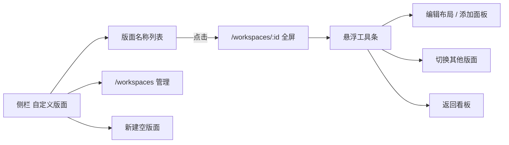

# 自定义版面（通达信式工作区）

> 范围：`apps/stock-dashboard` 新增「自定义版面」一级能力  
> 对标：通达信 PC 自定义版面（多套命名布局 + 全屏工作区）  
> 复用：总览 Portal（`pages/Dashboard/portal`）栅格引擎与组件 Catalog  
> 执行计划：[`dev-plan-custom-workspaces.md`](./dev-plan-custom-workspaces.md)  
> 状态：**已拍板并落地一期**

---

## 1. 背景与目标

总览 `/` 已是可编辑 Portal（12 列栅格、浏览/编辑双模式、localStorage），但：

- 只有**一套**隐含布局，类型里虽有 `presets[]`，UI **无**新建/切换/删除
- 始终包在侧栏 + 顶栏里，信息密度不如交易终端「整屏版面」
- 无法嵌入第三方网页（研报、日历、外部行情等）

产品目标：**把「自定义版面」做成独立一级菜单**——多套命名工作区、点开即全屏（无顶栏无侧栏），组件先复用总览 Catalog，并提供 **iframe 嵌入**。

非目标（一期）：

- 服务端同步 / 跨设备
- 总览与自定义版面共用同一套 storage（刻意隔离，避免互相踩）
- 任意嵌套容器、Grafana 式 Query 编辑器

---

## 2. 信息架构与路由

| 路径 | Chrome | 用途 |
|------|--------|------|
| 侧栏「自定义版面」展开 | 有侧栏 | 列出已存版面名；新建 / 管理 |
| `/workspaces` | 有侧栏+顶栏 | 管理页：重命名、复制、删除、设为默认打开 |
| `/workspaces/:id` | **无**侧栏/顶栏/页脚 | 全屏工作区：只渲染自定义面板 |



---

## 3. 与总览 Portal 的关系

| 项 | 总览 `/` | 自定义版面 |
|----|----------|------------|
| 引擎 | `PortalCanvas` + RGL | **同一套** |
| Catalog | `WIDGET_CATALOG` | **同一套** + `embed.iframe` |
| 数据 | `DashboardDataContext` + `PortalMarketsContext` | 工作区页**复用同一拉取逻辑** |
| 持久化 | `stock-dashboard:overview-portal:v9` | `stock-dashboard:custom-workspaces:v1` |
| 多套布局 | 数据结构有、UI 无 | **CRUD 一等公民** |

总览保持「默认看盘仪表盘」；自定义版面才是用户拼装的交易工作台。

---

## 4. 交互设计（含相对通达信的增强）

### 4.1 侧栏

- 「自定义版面」为可展开分组（非单跳转）
- 子项 = 已存版面名称；当前全屏打开的高亮
- 底部分割：`+ 新建`、`管理…`
- 侧栏收起时：分组缩为图标，点击仍进最近打开的版面或管理页

### 4.2 全屏工作区

- 无侧栏、无顶栏、无页脚；内容区贴边（同总览 tight）
- **悬浮条**（右上，类似总览 FAB 增强）：
  - 当前版面名（可点切换列表）
  - 编辑布局 / 完成
  - 添加面板
  - 刷新
  - 返回看板（`/`）
- 快捷键：`E` 切换编辑；`Esc` 退出编辑（不退出页面）

### 4.3 版面管理

- 新建：空布局（可立即加面板）；默认名「未命名版面 N」
- 重命名、复制（深拷贝 layout+widgets）、删除（至少保留 1 套时禁止删光，或删光后自动建空套）
- 「设为默认打开」→ 写入 `lastOpenedId`；侧栏点分组图标时跳此套
- 导出/导入 JSON（一期可做导出；导入作为二期亦可，本方案一期含简易导入）

### 4.4 iframe 面板（一期必做）

| 字段 | 说明 |
|------|------|
| `type` | `embed.iframe` |
| `config.url` | https URL（禁止 `javascript:` 等） |
| `config` / `title` | 面板标题，默认「网页」 |
| sandbox | `allow-scripts allow-same-origin allow-popups allow-forms`（可配置收紧） |
| 尺寸 | 默认 6×12；min 4×6；max 12×60 |

编辑态：URL 为空时面板内显示配置表单；菜单「配置网页」可再打开。

---

## 5. 数据模型

```ts
interface WorkspacePersistedState {
  version: 1;
  density: 'tight' | 'comfortable';
  lastOpenedId: string | null;
  workspaces: Array<{
    id: string;
    name: string;
    layout: PortalLayoutItem[];
    widgets: PortalWidgetInstance[]; // 可含 embed.iframe + config
  }>;
}
```

- 写盘 debounce 300ms（与总览一致）
- 合法校验：未知 `type` 丢弃；iframe URL 非 http(s) 清空

---

## 6. UI 原则

- 全屏工作区：**一块工作面**，避免再套管理仪表盘感
- 悬浮条克制，默认收成 FAB，展开才出菜单（沿用总览 `PortalToolbar` 气质）
- 管理页可有列表交互容器；工作区本身不用卡片墙堆营销信息

---

## 7. 验收要点

1. 侧栏可见「自定义版面」及子版面列表；可新建。
2. 打开版面后无顶栏、无侧栏，仅面板 + 悬浮工具。
3. 编辑态可拖拽/缩放/添加/移除；组件与总览 Catalog 一致，另含 iframe。
4. 刷新后布局与名称仍在；可重命名/复制/删除。
5. iframe 可配置 URL 并渲染；非法协议被拒绝。
6. `./scripts/build_dashboard.sh` 后 `/dashboard/workspaces` 与 `/dashboard/workspaces/:id` 可用。
