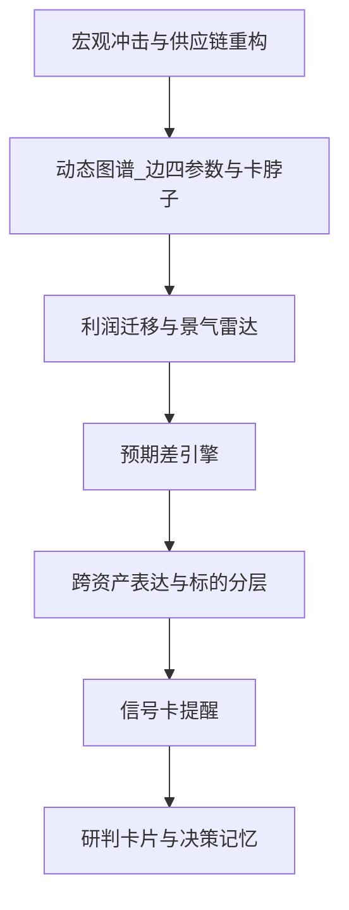

# 全球产业链情报台 — 产品愿景

> 目的：从全球多资产配置视角，定义「产业链分析 / 观察 / 买卖提醒」模块应长成什么样——把物理链、利润链、政策链、价格链叠成可观察、可推演、可提醒的操作系统。  
> 性质：产品愿景与交互纲领（非交易建议、非工程实现细则）。工程分期与数据源细节后续另文补充。  
> 关联：[`financial-market-transmission-chains.md`](./financial-market-transmission-chains.md)（冲击→跨资产底层传导）；[`global-macro-watchlist-and-regime.md`](./global-macro-watchlist-and-regime.md)（宏观枢纽与 Regime）；[`announcement-impact.md`](./announcement-impact.md)（公告四级异动可对齐提醒分级）；研判工作台见 [`炒股战法/研判工具设计-交互总览.md`](./炒股战法/研判工具设计-交互总览.md)。  
> 外部对照：  
> - [问财分享](https://www.iwencai.com/chat/share/?traceId=20003020179568257750800000000583&comeFrom=WebShareLink)（§9）  
> - [Wind Alice 分享](https://alice.wind.com.cn/share/01a2170d-5a55-7000-b328-aae9a589f000)（§10）  
> 日期：2026-11-26（Wind Alice 对照修订同日）  
> 状态：草案，可继续按外部资料完善（见文末「待补充清单」）。

---

## 0. 一句话总览

产品命题不是「再做一个产业链图谱」，而是：

**一台「全球产业利润迁移的实时雷达 + 传导推演机 + 可执行提醒系统」**——把物理现实翻译成利润迁移，再翻译成可执行动作； ideally **价格动之前先响，下单之前先说清理由，判断错了第一个提醒你**。

### 0.1 为什么现有产业链工具常被顶尖资金冷落

| 现状 | 真实感受 |
|------|----------|
| 静态漂亮连线图 | 图好看，但不说钱往哪流 |
| 库存/价格/产能堆砌 | 要的是因果与时滞，不是数据柜 |
| 单市场切片（A/美/港各讲各的） | 同一条链是一盘棋，不该切成四块 |
| 事后解释「为什么涨了」 | 要的是链条已绷紧、价格未动的那几天 |

### 0.2 产品章程：三条第一性原理（写入后续 PRD）

1. **链条是活的神经网络，不是组织架构图。** 每条边必须带：依赖权重、价格传导弹性、时滞、置信度——缺一则是装饰。  
2. **一切以利润池迁移为最终语言。** 价格/库存/运价/开工只是中间变量；界面要翻译到「谁的毛利在扩张/收缩、谁有议价权」。  
3. **信息找人，且提醒必须自带结论。** 「铜涨 2%」是噪音；合格推送 = 发生了什么 → 路径 → 标的与方向 → 历史胜率/样本 → **建议动作**。没有动作行的提醒不许发。

### 0.3 三层定价 + 五句操作问题

| 定价层面 | 核心问题 | 本平台对应能力 |
|----------|----------|----------------|
| **产业链重构定价** | 近岸/友岸/中国+1：哪些环节迁移或强化？ | 地理叠层 + 重构模式 + 脆弱性/卡脖子扫描 |
| **利润池迁移定价** | 议价权在谁手里？ | 价差/毛利瀑布 + 地区×环节利润热力 + 景气雷达 |
| **冲击传导 / 预期差定价** | 冲击落点、表达工具、轮动时点；现实与价格是否背离？ | 冲击沙盘、事件倒计时清单、预期差雷达、可审计提醒 |

操作问题（驱动 UI）：

1. **冲击打在哪一环**  
2. **利润落在哪一环**  
3. **用什么资产表达**  
4. **何时轮动**  
5. **现实与价格谁领先**（预期差：最佳买点 / 已过度定价）

定位口号：**「看见钱在链上怎么流，再决定在哪一环下注。」**

```text
真实世界 / 宏观冲击 / 供应链重构
        ↓
动态图谱（环节节点 + 边四参数 + 卡脖子）
        ↓
利润迁移与景气（领先→同步→滞后）
        ↓
预期差引擎（景气 vs 价格 / 卖方预期）
        ↓
跨资产表达 + 标的受益分层
        ↓
信号卡提醒（触发→路径→标的→置信→动作）
        ↓
研判交易卡片 / 观察池 / 决策记忆与红队（后期）
```



---

## 1. 工具形态：Industrial Chain OS

**Situation Room 壳 + 四种模式**（不拆成四套独立站点）：

| 模式 | 一句话 | 谁在用 |
|------|--------|--------|
| **态势总览** | 哪条链异动、卡脖子在哪、利润往哪迁 | CIO / 宏观 + 行业 PM |
| **单链作战室** | 供需、库存、价格、利润、沙盘、时滞 | 研究员 / 交易员 |
| **标的穿透** | 以个股/商品为中心反查上下游与受益逻辑 | 自下而上研究 |
| **提醒与轮动台** | 信号卡流、背离榜、观察池 | 执行与风控 |

产品边界：**结构 + 传导 + 提醒**；不替代个股六维打分，不自动下单。仓位建议只进交易卡片模板。

桌面做研究与推演；**移动端只做决策**（P0/P1 信号卡 +「看证据 / 加观察 / 忽略」），不做深度研究。

### 1.1 你具体怎么用（按场景，不是按菜单）

上线后你**不会**面对「全球一万个行业任选」——左侧是一份 **精编主链目录**（见 §1.2），深度随分期变厚。日常用法就四条：

| 场景 | 你怎么做 | 系统给你什么 |
|------|----------|--------------|
| **早会扫一眼（2–5 分钟）** | 打开态势总览 / 信号流 | 昨夜–今晨 U0/U1 信号卡；哪条链景气/卡脖子变色；一句态势 |
| **大事冲击（地缘/政策/灾害）** | 点事件或拖冲击芯片进沙盘 | L1–L3 传导、受益/受损标的（已分层）、周/月/季跟踪 checklist |
| **自下而上盯一只票/商品** | 搜索标的 → 标的穿透 | 它挂在哪个**环节**、上下游、受益层级、是否概念关联、链是否支持 |
| **找预期差（最赚钱用法）** | 进背离雷达 / 卖方滞后榜（P2+） | 「链已绷紧、价格未动」或「涨太多、现实未跟」的候选池 → 一键观察池/出卡片 |

**不该怎么用**：把本模块当「概念股导航」刷涨幅；对灰色未验证节点当结论；忽略 Regime 降级硬开行动级提醒。

**和现有模块的配合**：宏观 Regime / 日历定大环境 → 本模块定「打在哪一环、钱在哪」→ 研判工作台六维与交易卡片定仓位与退出。本模块**不代替下单**。

### 1.2 到底能列出哪些产业链？

**答案先说清楚：不是全市场自动枚举，而是「精编主链目录 + 后期可扩展」。**  
Wind/问财那种「五千条产业库」是数据商愿景；按本文开发，你打开产品时左侧看到的是下面这张**官方主链清单**，分期解锁深度（有图谱 / 有提醒 / 有背离）。

#### A. 官方主链目录（建议锁定为产品目录，可改名不可无限膨胀）

| ID | 主链 | 为何进目录 | 建议解锁 |
|----|------|------------|----------|
| C01 | **半导体（含设备/材料/设计/制造/封测）** | 全球定价、卡脖子清晰、跨美台韩日中 | **P0 唯一做透（已拍板）** |
| C02 | **铜（矿→冶炼→加工→下游用电）** | 「博士铜」+ 宏观枢纽，价差/TC 数据相对好拿 | P1+ 占位，P0 目录可显示「建设中」 |
| C03 | **新能源车 / 锂电 / 储能** | A 股表达深、环节多、利润迁移故事完整 | P1+ 占位，P0 目录可显示「建设中」 |
| C04 | AI 算力（芯片–服务器–光模块–电力/液冷） | 与 C01 / C05 交叉，可作子视图或独立链 | P1–P2 占位 |
| C05 | **云计算数据中心（IDC→算力→软→安全→集成→应用）** | Wind 报告可结构化导入；A 股 IT 服务表达深 | **已开放 L-观察（报告导入）** |
| C06 | 关键矿扩展（铝 / 锂 / 镍，可与 C03 交叉） | 商品+股市双表达 | P2–P3 |
| C07 | 航运 / 港口 / 集装箱 | 地缘与运价领先信号强 | P2–P3 |
| C08 | 石油–天然气–化工 | 冲击沙盘经典链，跨资产完整 | P2–P3（原草案 C05 让位给云链） |
| C09 | 粮食 / 化肥 / 软商品 | 气候+出口禁令场景 | P3–P4 |
| C10 | 军工 / 航发 | 政策与订单驱动，需强证据分层 | P3–P4 |
| C11 | 创新药 / 医疗器械 | 事件驱动强，链结构与周期链不同 | P3–P4 |
| C12 | 中国地产–建材（可选区域链） | 内需温度计，全球配置权重低 | P4 可选 |

**P0 拍板（2026-11-26）：先做透 C01 半导体。**  
**增量（同日）：C05 云计算数据中心** 以 Wind Alice《常山北明》报告精编入库（锚点公司 + 毛利带 + 可比标签 + 链条风险），深度 **L-观察**；C02/C03/C04 仍占位「建设中」。  
目录上限仍锁在上表，**不提供「任意行业名生成一条链」**——报告只进精编流程，不直接变概念股库。

### 1.2.1 报告驱动导入范式（C05 示范）

卖方/Alice 类「单公司产业链报告」映射到本系统本体时，只吸收可审计字段：

| 报告常见块 | 图谱字段 | 用法 |
|------------|----------|------|
| 产业链环节图 | `segments` + `edges`（四参数人工补） | 骨架；概念层（如「数字经济」）不建环节 |
| 环节毛利区间 | `segment.grossMarginHint` / `valueRole` | 利润池语言，禁止当精确财务 |
| 与锚点可比性 | `membership.peerTag`（focal/high/mid/low/up/down） | 信号卡只拿高可比对照毛利 |
| 锚点公司财务摘录 | `focalEntityId` + `entity.revenueMix` | 深潜侧栏置顶，不当全链估值 |
| 关键变量/风险 | `chainRisks` + 景气指标卡 | 生成观察级信号，默认不升行动级 |
| 价值分配一句话 | `valueLaw` | Situation Room 叙事锚 |

流程：**报告 → 人工精编种子 → 草稿/发布**；外源自动增量仍只进候选箱。

#### B. 「目录里有」≠「全都一样深」

| 深度档 | 含义 | 用户侧体验 |
|--------|------|------------|
| **L-图谱** | 环节 + 边四参数 + 公司挂载 + 受益分层 | 能点开看结构与标的 |
| **L-观察** | + 景气/价差 + 信号卡 | 能每日盯、能收提醒 |
| **L-推演** | + 沙盘 + 卡脖子扫描 + 事件 checklist | 能做冲击推演 |
| **L-定价** | + 背离雷达 + 跨市场对照 | 能系统化找预期差 |

P0 目标：**C01 到 L-图谱（可带骨架级先行指标字段）**；P1 将 **C01 升到 L-观察**；P2 将 **C01 升到 L-推演/L-定价**。C02/C03 等其余主链 P0 仅占位，避免空壳承诺。

#### C. 和「行业分类」的区别

- **不是** GICS/申万一级行业列表（那是分类，不是传导网络）。  
- **一条主链** = 一张带边参数的环节网络 + 跨市场标的挂载。  
- 用户搜「宁德时代」→ 落到 C03 某环节，而不是落到「申万电池指数成分」一页。  
- 子链/视图（如「AI 算力」从半导体与电力交叉）用 **视图** 表达，慎另开无限新主链 ID。

#### D. 若你个人还想看目录外的链

产品原则允许：**用户自建观察链（后期）** 或运营人工加链——但默认官方目录仍以上表为准；自建链默认无完整回测胜率、灰色置信度更高。

---

## 2. 功能体系（按决策顺序）

### 2.1 动态产业链图谱（World Chain Atlas）

**本体纪律（Wind Alice 强化）**：

- **节点 = 环节**（如「锂电铜箔」「电子级氢氟酸」），**不是**默认一家公司；公司/工厂挂在环节下。  
- **边 = 供应/传导关系**，强制四参数：  
  - **权重**（依赖度 / 营收或用量占比）  
  - **弹性**（价格传导系数，给区间而非假精确点估计）  
  - **时滞**（周/月）  
  - **置信度**（证据来源；定期证伪回测，防伪相关画成因果）  
- 边上可附：集中度 CR3、可替代性/切换成本、库存天数、合同类型（长协/现货）。

**卡脖子自动扫描（可规则化）**：

> 集中度高 **且** 可替代性低 **且** 库存天数低 → 标为卡脖子 / 高脆弱节点；按「出事概率 × 影响金额」排序。  
> 景气瓶颈 ≠ 中断脆弱性，但常重叠；界面需可区分着色。

其他：

- 环节序列：资源 → 加工 → 核心部件 → 整机/应用 → 渠道/运营商  
- 预置 8–12 条全球主链（可扩展；P0 先 1–3 条做透）  
- **地理 ⇄ 逻辑双视图**：地图看地缘/关税/产能迁移；拓扑看上下游利润传导——地缘时代两者必须一键切换  
- **重构模式**：近岸 / 友岸 / 中国+1 迁移路径  
- **全球利润池热力图**：横轴=环节（上→下），纵轴=地区（中/美/日/欧/台/韩…），色块=毛利扩张速度——一眼「钱在往哪走」

> **范围纪律**：不以全产业库/全量贸易流为近中期 KPI；先精编主链（见 §9–§10）。

### 2.1.1 动态可调：骨架稳、成员活（回答「公司很多且不断加入」）

**能支持手动动态调整，也支持外部数据源持续提议更新——但默认不是「数据源一来就自动改官方链」。**  
半导体尤其如此：A 股概念股每周都有新面孔，若自动全收，图谱会立刻沦为题材库。

架构拆成三层变更面，变更频率与审批强度不同：

| 变更面 | 改什么 | 谁改 | 频率 | 默认策略 |
|--------|--------|------|------|----------|
| **S 骨架（环节+边）** | 增删环节、改上下游边、改边四参数 | 运营/研究员（Chain Editor） | 低（季/事件驱动） | **仅人工提交 + 审核发布**；系统可「建议」新环节，不自动上骨架 |
| **M 成员（公司挂载）** | 公司挂到哪个环节、受益分层、业务占比、证据 | 人工为主；机器出**候选** | 高（日/周） | **候选箱 → 一键采纳/驳回/降为概念关联** |
| **V 视图/观察池** | 用户自建关注子集、临时主题 | 终端用户 | 随时 | 不影响官方 C01 发布版 |

```text
外部数据源 ──提议──▶ 候选变更箱（Candidate Inbox）
                              │
              ┌───────────────┼───────────────┐
              ▼               ▼               ▼
         建议新环节       建议挂载公司     建议改边/参数
         （低频）         （高频）         （中频）
              │               │               │
              └──── 人工审核 / 规则预检 ──────┘
                              │
                              ▼
                    发布版图谱（Published）
                    + 草稿版（Draft）
                    + PIT 版本号（何时生效）
```

#### A. 手动编辑能力（P0 就必须有）

Situation Room / 后台 **Chain Editor** 支持：

1. **环节**：新增 / 停用 / 重命名 / 合并（保留别名映射）；不物理删除历史（PIT）  
2. **边**：拉线、改四参数、标注证据链接；停用边而非抹掉  
3. **公司挂载**：搜索多市场代码 → 挂到环节 → 设受益层（核心/弹性/间接/概念）→ 填业务占比或「未知」  
4. **批量**：CSV/JSON 导入导出（研究员离线改完再导入草稿）  
5. **发布**：草稿 → 预览 → 发布；发布写版本号与操作者；可回滚到上一发布版  
6. **个人覆盖（可选）**：用户可把某公司「钉」进自己的观察视图，不写入官方 C01  

P0 最低交付：**能对 C01 做上述 1–5（UI 可先简陋），没有编辑器就等于假动态。**

#### B. 机器候选，不机器独裁（P1 起接通数据源）

任何外源更新先变成 **Candidate**，带：来源、时点、建议动作、证据摘要、建议受益层、置信度。  
**未经采纳，不得进入行动级提醒的官方标的池**；最多以灰色「待审核成员」展示。

自动预检规则示例（采纳前）：

- 已在其他环节且冲突 → 提示「多环节挂载，需确认主环节」  
- 仅有概念板块标签、无收入/客户/产品证据 → 默认建议 **概念关联**  
- 同一实体多代码未对齐 → 先入实体对齐队列  
- 市值过小或停牌退市 → 默认不进核心池  

#### C. 外部数据源如何「不断更新生态」（按可获得性排序）

| 源类型 | 能更新什么 | C01 示例 | 接入阶段 |
|--------|------------|----------|----------|
| **人工/研报策展** | 骨架+成员+参数 | 研究员季度校准 ASML→台积电权重 | **P0** |
| **交易所/行情主数据** | 代码、名称、上市退市 | 新股进候选「待挂环节」 | P0–P1 |
| **公告 / 招股 / 年报业务构成** | 产品线是否涉半导体设备/材料/IC | 「公司 X 披露光刻胶收入」→ 建议挂材料环节 | **P1**（接现有公告异动） |
| **客户/供应商披露** | 关系边、权重线索 | 「是中芯国际供应商」→ 建议边或挂载 | P2–P3（覆盖不全） |
| **产业链/概念板块映射**（同花顺/东财/Wind 等） | 粗粒度成员候选 | 「半导体概念」成分变动 | P1 作**候选**，禁止直接当核心 |
| **招投标 / 中标** | 弹性成员、订单证据 | 设备厂中标晶圆厂 | P2 |
| **专利 / 招聘** | 早期布局信号 | 某厂大量招「EUV 工艺」 | P3–P4，高噪声 |
| **贸易/海关 HS** | 进出口结构、地理重构 | 设备/材料进出口 | P3–P4 |
| **用户/社区提交** | 冷门标的补全 | 「请审核把 XX 挂到 CMP 抛光液」 | P2+ 审核流 |

**原则：源只产生候选与证据，发布权在人（或严格白名单规则）。**  
「动态加入产业链」在产品里的正确形态是：**今天出现在候选箱 → 审核后挂到正确环节并分层 → 次日才进入观察/布局池**；而不是收盘自动全员入链。

#### D. 成员生命周期（解决 A 股「题材进进出出」）

| 状态 | 含义 | 可否进行动级提醒 |
|------|------|------------------|
| `candidate` | 外源或用户提议，未审 | 否 |
| `concept` | 已挂载但证据弱 | 否（仅情报） |
| `active` | 已审，核心/弹性/间接 | 按分层规则 |
| `watch_only` | 曾活跃，逻辑变弱，降级观察 | 否 |
| `deprecated` | 退市/主业切换/误挂 | 否；保留 PIT 历史 |

主业切换、被移出官方概念、连续 N 季无相关收入 → 自动或半自动建议 `watch_only` / `deprecated`，避免僵尸成员污染卡脖子与背离计算。

#### E. 骨架何时才动（半导体也会变，但慢）

新环节（如「HBM 先进封装」「SiC 衬底」）的触发：

1. 候选箱出现多次「无合适父环节可挂」  
2. 或重大技术/政策事件（出口管制清单新类别）  
3. → 研究员开草稿：加环节、迁公司、改边 → 发布新版本  

**不在日频自动长出新骨架节点。** 否则拓扑每周变形，传导与回测全部失效。

#### F. 数据模型要点（便于工程实现）

- `Chain` / `Segment`（环节）/ `Edge`（含四参数与版本）  
- `Entity`（跨市场对齐）/ `Membership`（entity↔segment，含 tier、status、evidence、as_of）  
- `ChangeProposal`（候选箱）/ `ChainRelease`（发布版快照）  
- 所有分析默认打在 **某 release + as_of 日** 上（PIT）

---

### 2.2 冲击注入与传导沙盘（Shock Injector）

- 冲击芯片拖入，或 **多滑块沙盘**（原油 +20%、汇率 −5%、关税 +10% 等）实时重排利润池与标的排序  
- 建模：**历史回归弹性 + 专家先验 + 供需平衡表**；系数给 **区间 + 置信度**  
- 输出分层：

| 传导层 | 含义 | 必须标注 |
|--------|------|----------|
| **L1 直接落点** | 供需/成本/政策直接命中 | 业务占比、订单能见度 |
| **L2 配套/弹性** | 间接环节 | 弹性区间、投产/认证进度 |
| **L3 逻辑切换** | 国产替代、路线切换、估值期权 | 兑现证据等级 |
| **表达建议** | 跨资产怎么下注 | 干净度、拥挤度 |

- 区分 **业绩增量 vs 情绪映射**；概念关联不得进入行动级  
- **事件倒计时跟踪清单（强借鉴）**：政策/灾害发生后，自动列出第 1 周 / 第 1 月 / 第 1 季各环节「可验证变化」，形成跟踪 checklist（把叙事变成可勾选证伪）

### 2.3 利润与景气仪表（Margin & Cycle Radar）

**原则**：景气 = 多维信号方向一致性；领先 / 同步 / 滞后分层；禁止季频财务日频化。  
**关键（Wind Alice）**：监控的不是裸数值，而是 **相对季节性 / 历史分位的偏离**。

| 层级 | 类型 | 示例 | 频率 |
|------|------|------|------|
| 领先 | 价格/订单 | 现货与价差、新签订单、排产、招标 | 日/周 |
| 领先 | 另类（有则用） | 运价/AIS、海关高频、开工代理 | 日/周 |
| 同步 | 产能/产量 | 利用率、开工率、产量增速 | 月 |
| 同步 | 财务验证 | 营收、合同负债、在建工程 | 季 |
| 滞后 | 库存/利润/开支 | 产成品库存、应收、毛利率、capex | 季/年 |

常驻：价差曲线、上下游交叉验证、利润瀑布、扩产日历、景气拐点候选、周期位置对比。  
链专属领先信号示例：半导体（设备出货、稼动、存储现货、交期、capex 指引）；新能源（排产、辅材开工、招标、海外装机、锂盐库存天）；航运（AIS 拥堵、运价、空箱比）等——P0 链各配一张「先行指标卡」。

### 2.4 预期差与定价引擎（Expected Gap）— 投资人「圣杯」层

持续计算三类背离（P2 起产品化，字段 P1 可先露出）：

| 背离 | 含义 | 倾向动作 |
|------|------|----------|
| **价格领先现实** | 涨太多，链条未绷紧 | 减仓/做空观察 |
| **现实领先价格** | 链条已绷紧，股价未动 | 最佳买点候选 |
| **卖方预期滞后** | 高频链信号已改善，分析师未上修 | 预期上修领先榜 |

**背离雷达**：横轴=产业链景气变化，纵轴=股价/估值变化；**左下角**（景气改善、价格未动）高亮。  
与拥挤度（基金重仓、期权偏斜、空头、北向等可得字段）同屏，避免「景气改善但人人已上车」。

### 2.5 跨资产表达层与标的分层

| 表达类型 | 示例 |
|----------|------|
| 商品期货/现货 | 铜、锂、布油、运价 |
| 区域股指/行业 ETF | SOX、清洁能源、中国有色 |
| 核心个股（多市场） | 台积电、ASML、宁德、必和必拓 |
| 汇率/利率代理 | AUD、CLP、CNY |
| 信用/波动 | HY、隐含波动 |

**跨市场映射对照**：同一环节在多市场标的并排——估值分位、利润弹性、拥挤度同屏（「A 股故事的全球定价」）。

**受益分层**：

| 层级 | 定义 | 默认处置 |
|------|------|----------|
| 核心受益 | 订单/收入可验证 | 可进布局/行动候选 |
| 弹性受益 | 产能/认证可追踪 | 战术观察后升级 |
| 间接受益 | 配套/总量逻辑 | 默认观察池 |
| 概念关联 | 仅标签 | **仅情报**；禁止行动级 |

必标：链位置、业绩增量/估值期权/情绪映射、证据等级、业务占比与弹性、估值分位与拥挤度。

### 2.6 沿链轮动引擎

阶段：收缩 / 去库 / 价格启动 / 利润扩散 / 扩产兑现 / 过剩回落。  
时滞表承认牛鞭与非线性；轮动用 **条件→动作** 模板。  
技术替代场景：瓶颈环节迁移时，**标的池换血提醒**（如锂→设备）。

### 2.7 观察与买卖提醒（信号卡）

禁止黑盒「AI 说买」。**没有「动作」行的提醒一律不发。** 降噪：同逻辑聚合；支持「已知晓 / 不再提醒此类」静音；**宁可漏报，不可误报**（误报三次用户永久关推送）。

**动作强度（四级）**：

| 级别 | 含义 |
|------|------|
| 情报 | 值得盯 |
| 观察 | 进观察池，待确认 |
| 布局 | 多因子共振，底仓假设 |
| 行动 | 交易卡片模板（含失效条件） |

**触达紧急度（与强度正交，借鉴 Alice P0/P1/P2）**：

| 紧急度 | 含义 | 渠道建议 |
|--------|------|----------|
| U0 立刻看 | 卡脖子突发、断供、指引骤变 | 强提醒（桌面+移动） |
| U1 今日看 | 背离触发、新受益标的 | 应用内信号流 |
| U2 本周看 | 景气排名/拥挤/季节性 | 日报摘要 |

**信号卡固定五段**：

```text
【触发】发生了什么（来源 + 时点）
【路径】沿哪条边传导（带时滞/弹性区间）
【标的】受益/受损（分市场，附弹性%；遵守受益分层）
【置信】历史同类 N 次、胜率、样本偏差警告
【动作】建议关注/减仓/对冲/加观察池 → 一键进池或生成卡片
```

**类型标签**：景气拐点、利润迁移、事件传导、脆弱性/卡脖子、预期差/背离、卖方预期滞后、相对强弱背离、供应链动量（P4）、Regime 降级。

每条信号保留「发出时判断」与事后 1 周/1 月/1 季结果 → **个人/系统信号胜率档案**（时间护城河）。

### 2.8 证据链与叙事

剥洋葱四层：**结论 → 传导路径 → 原始信号 → 数据源与时点（Point-in-Time）**。  
AI 汇总翻译；规则出分。景气改善 ≠ 未定价。

### 2.9 组合链暴露（后期）

持仓映射图谱、隐性集中度、CR/HHI、路线替代；上限进卡片模板。  
**一句话日报（可选）**：昨夜链上最重要一事 + 与我的观察池/持仓如何相关。

### 2.10 AI 红队与决策记忆（P3+，与研判工作台共建）

- 可追问：「为什么 2022 年这条传导失效？」  
- **红队模式**：主动给反方观点与历史失败案例  
- **决策记忆**：记住用户对某链的假设与理由，到期检查证伪并提醒——市面少见、PM 刚需  

---

## 3. 交互与信息架构

### 3.1 Situation Room（驾驶舱）

左脑看图、右脑看信号（Alice 双栏思想，与本方案三栏兼容：左导航 + 中图 + 右信号/深潜）：

```text
┌─────────────┬──────────────────────────────┬─────────────────┐
│ 链导航/搜索  │  活拓扑 / 地图 / 利润热力 / 沙盘 │ U0/U1 信号流     │
│ Cmd+K        │  节点=环节  边闪烁=正在传导      │ 五段式信号卡     │
│ 模式切换     │  时间轴擦洗器                    │ 观察池 / 背离入口 │
│ 今日异动     │                                │ 一键生成卡片     │
└─────────────┴──────────────────────────────┴─────────────────┘
```

**信息三层**：概览 → 分析 → 原始数据；默认只露异常。  
**命令面板 Cmd+K**：`铜 传导` / `固态电池 瓶颈` / `观察池 背离` 直达。

### 3.2 关键交互

1. 单击环节节点 → 深潜 + 路径高亮  
2. 双击 → 标的穿透或公司列表  
3. 右键边 → 编辑四参数（权重/弹性/时滞/置信）  
4. 冲击芯片 / 多滑块沙盘 → L1–L3 + 利润池重排  
5. 时间 scrubber → 景气爬行与关系演变  
6. 地理 ⇄ 逻辑一键切换  
7. 事件标记线 + **倒计时 checklist**  
8. Compare 双链  

### 3.3 UI 视觉语言

- 作战室气质；少装饰  
- 颜色：瓶颈/卡脖子=琥珀；利润扩张=冷色；受损/过热=收敛红；信号=克制强调色；**未验证=灰**  
- 节点大小≈利润规模或贸易量；边粗≈依赖权重；边闪烁≈正在传导  
- 第一屏：链名 + 一句态势 + 主画布；禁止营销堆砌  
- **一分钟看懂一条链、一张卡**；复杂度藏底层  

### 3.4 用户动线

| 路径 | 动线 |
|------|------|
| A 自上而下 | Regime/冲击 → 链 → 卡脖子/利润 → 表达与分层 → 信号卡/卡片 |
| B 自下而上 | 标的 → 环节位置与受益层 → 上下游与背离 → 卡片 |
| C 情报驱动 | 信号流 → 剥洋葱证据 → 观察池/卡片 |
| D 预期差 | 背离雷达左下角 → 卖方滞后榜 → 布局假设 |

---

## 4. 与现有模块的咬合

| 已有能力 | 如何接 |
|----------|--------|
| 宏观传导 / Regime | 冲击类型、提醒降级 |
| 全球宏观观察清单 | 多链共用气象站 |
| 研判工作台 / 交易卡片 | 信号卡【动作】→ 预填假设/证据/退出；红队与决策记忆共建 |
| 组合风控 | P3+ 链暴露与隐性集中度 |
| 公告异动 | 事件流；概念关联不上行动级 |
| 金融日历 | 冲击候选 |

---

## 5. 数据与建模（愿景层）

1. **图谱本体**：环节 / 边四参数 / 地理 / 卡脖子；**草稿+发布+回滚**（见 §2.1.1）  
2. **成员挂载**：Membership 状态机（candidate→concept/active/…）；受益分层与证据  
3. **候选变更箱**：外源与用户提议统一入库，人工或白名单规则采纳  
4. **实体对齐（护城河）**：多语言名、代码、集团、工厂别名  
5. **Point-in-Time**：分析与回测绑定 `ChainRelease` + `as_of`，禁未来函数  
6. 价格与价差、库存/开工代理、事件流  
7. 提醒 DSL：条件 → 类型 × 动作强度 × 紧急度 → 五段信号卡  
8. 数据血缘：来源、口径、频率、修订；另类数据带置信度  

后期：客户供应商披露、贸易流/AIS、招投标/专利/招聘、动量因子研究轨。  
**真正难复制的**：实体对齐 + PIT + 弹性校准 + 信号胜率档案 + **可持续的策展工作流**——不是「又一个静态数据库」。

---

## 6. 产品分期（默认路线）

**成功标准（Alice 强化）**：先把 1–2（最多 3）条链做到 **「比别人早约 3 天，且能说清为什么」**；交易员愿意每天打开。不做全球全产业链开张。

| Phase | 交付 | 验证什么 |
|-------|------|----------|
| **P0** | **仅 C01**：环节图谱 + 边四参数 + 公司挂载 + 受益分层 + Situation Room；**Chain Editor（草稿/发布/导入）**；C02/C03 占位 | 能否手动画链、挂公司、发版 |
| **P1** | 景气/价差 + 信号卡 + **候选箱**（公告/概念板块/新股 → 建议挂载，人审） | 成员能否周更而不污染核心池 |
| **P2** | 沙盘 + 卡脖子 + 背离雷达 + 跨市场映射；客户供应商/招投标候选 | 动态成员 + 可回测假设 |
| **P3** | 重构、事件 checklist、组合暴露、Cmd+K；用户提交审核流 | 作战室闭环 |
| **P4** | 更多链、另类数据、弹性校准、红队/决策记忆、移动端、动量轨 | 决策系统 |
| **关系网（并行轨）** | 见 §6.1：企业×企业供货/投资/技术/产能视图 | 绑定结构可观察、可策展 |

问财「景气 + 事件传导」= P1 重心；Alice「图谱 + 简易传导 + 信号卡」= P0–P1；**背离雷达**上提为 P2 核心差异，不再只当拥挤度附属字段。

### 6.1 企业关系网开发计划（对照 cyl「美国 AI 产业链」）

**定位**：中央视图独立 Tab「关系」——节点=企业、边=供货/投资/技术/产能；**不替代**环节图谱（环节边仍管冲击传导）。对应 §2.1.1 的 **V 视图**，骨架仍是 segments + ChainEdge。

| 分期 | 交付 | 验收 |
|------|------|------|
| **R0（本期）** | 类型 `EntityRelation`；中央 Tab「关系」；按环节分行的企业卡片 + 彩色关系边；类型筛选 / 搜索 / 点击聚焦 / 悬停预览；有锚点时默认 **ego 一阶邻居**；C05 全量关系种子 + C01 示范；深潜「在关系网查看」；⌘K；编辑器增删关系；证据等级展示 | 能在 C05 以常山北明为中心看清绑定 |
| **R1** | 关系候选箱（公告/工商提议）；关系突变→情报级信号；行情角标 | 周更关系不污染官方版 |
| **R2** | 跨链关系；沙盘仅高置信 `supply/capacity` 可选映射；密度折叠 | 与传导边界清晰 |

**纪律**：
1. `invest` / `tech` **默认不进**冲击沙盘 L1–L3。  
2. 每条关系必有 `evidenceGrade`；`unverified` 灰显。  
3. 外源只进候选，人工发布。  
4. 双挂企业用「主挂载环节」落位，卡片标注次挂载。  

**相对 cyl 补强（本期已含）**：证据等级、锚点 ego、复用本链 entities/memberships、与深潜/⌘K/编辑草稿发布打通、关系不进沙盘。

---

## 7. 使用边界、陷阱与风险

**三个产品陷阱**：

1. **伪相关**：同涨画成因果 → 边必须有证据与置信度 + 证伪回测  
2. **过度复杂**：功能越多越没人用 → 一分钟看懂链与卡  
3. **噪音推送**：提醒太多等于没有 → 宁漏勿滥、可静音、必须带动作  

其他：牛鞭与非线性；景气≠未定价；重构是长期过程；另类数据谨慎；动量因子可关闭；输出非投资建议。

---

## 8. 三句原则

1. **图谱是骨架（环节+边四参数），利润迁移是血液，预期差是准星，跨资产表达是枪，受益分层是保险丝。**  
2. **提醒必须是五段式可复核信号卡**，并与 Regime、概念关联降级、宁漏勿滥联防。  
3. **UI 是 Situation Room**：地理⇄逻辑、剥洋葱证据；60 秒进入状态，回答「打在哪、钱在哪、现实与价格谁领先、买什么、何时假」。  

---

## 9. 与问财分享文的对照（2026-11-26）

来源：[同花顺问财](https://www.iwencai.com/chat/share/?traceId=20003020179568257750800000000583&comeFrom=WebShareLink)

### 9.1 已借鉴

三层定价、脆弱性/重构、领先同步滞后、利润池文案、事件 L1–L3、受益四层、信号类型、信息三层、灰=未验证、组合暴露、P1=景气+事件、牛鞭与另类数据边界。

### 9.2 有意不采纳或降级

| 问财表述 | 立场 |
|----------|------|
| 全量产业/贸易库作近中期 KPI | 不作 KPI |
| 日频供应链动量绑死差异化 | P4 研究轨 |
| 自动动态仓位止损 | 仅卡片模板 |
| 红=利润上移又=风险 | 不采纳 |
| 四套独立页面 | Situation Room 模式 |
| 未复现超额年化作承诺 | 不进产品原则 |

---

## 10. 与 Wind Alice 分享文的对照（2026-11-26）

来源：[Wind Alice](https://alice.wind.com.cn/share/01a2170d-5a55-7000-b328-aae9a589f000)

整体评价：与本方案同源（利润迁移、活图谱、传导、跨市场、时间轴），但在 **预期差、信号卡形态、本体（环节≠公司）、边四参数、事件倒计时、PIT/实体对齐护城河、宁漏勿滥、红队/决策记忆** 上更锋利，已大量吸收。

### 10.1 新吸收并写入上文的点

- 产品章程三条第一性原理 + 「现有工具四宗罪」  
- 节点=环节、公司挂载；边强制权重/弹性/时滞/置信度  
- 卡脖子公式：高集中 × 低替代 × 低库存天  
- 地区×环节 **利润池热力图**；传导 **多滑块沙盘**；弹性用区间  
- **预期差引擎 / 背离雷达 / 卖方预期滞后榜**（P2 核心）  
- 信号卡五段 + 无动作不发；紧急度 U0–U2；胜率档案；宁漏勿滥  
- 事件后 **周/月/季可验证 checklist**  
- 地理⇄逻辑双视图；Cmd+K；移动端只决策  
- 实体对齐 + Point-in-Time 作为数据护城河  
- AI 红队 + 决策记忆（P3+）  
- 成功标准：「早约 3 天 + 说清为什么」；先 1–2 条链做透  
- 三陷阱：伪相关 / 过度复杂 / 噪音  

### 10.2 有意弱化或不照搬的点

| Alice 表述 | 立场 |
|------------|------|
| 非传统数据长名单作开场必杀 | 仍作后期能力；P0–P1 不绑卫星/招聘等 |
| P0 电话/手环级触达 | 渠道可扩展，产品原则不依赖硬件 |
| L0–L6 六层「每层可独立卖」 | 对内可作架构分层，对外仍一个 Situation Room，避免产品碎片 |
| 「核武器」等修辞 | 不进正式产品文案 |
| MVP 仅 1–2 条链 | **采纳精神**；本仓库可保留最多 3 条示范（半导体/铜/新能源）但必须「做透一条再铺」 |

### 10.3 与问财文的相对取舍

- 问财强在：受益分层防概念股、指标领先滞后表、重构/脆弱性产品名。  
- Alice 强在：预期差、信号卡纪律、本体与边参数、PIT、提醒降噪哲学。  
- 两者的「全量数据幻想」本方案统一降级；**精编 + 可审计 + 预期差** 作为主航道。

---

## 11. 待补充清单

### 11.1 图谱本体

- [x] P0 主链锁定：**C01 半导体**（2026-11-26）；C02/C03 占位  
- [x] 动态策展架构：骨架稳 / 成员活 / 候选箱 / 成员生命周期（§2.1.1）  
- [x] C01 种子图谱 + Situation Room + 本地 Chain Editor（`/industrial-chain`）  
- [x] P1：五段信号卡 + 景气指标卡 + 候选箱人审（本地示意源，2026-11-26）  
- [x] 编辑器：边四参数可改 + 成员挂载/分层 + JSON 导入导出/发布  
- [x] P2：传导沙盘 L1–L3 + 事件周/月/季 checklist + 背离雷达 + 跨市场表（2026-11-26）  
- [x] P3：重构叙事 + 组合链暴露 + ⌘K 命令面板 + 信号/黄金坑加自选（2026-11-26）  
- [x] P4 起步：真实行情刷新背离分位 + 信号/挂载涨跌展示；公告异动→候选箱（2026-11-26）  
- [x] C05 云计算数据中心：Wind 报告精编种子 + 多链 store + 锚点/毛利带/可比/链条风险 UI（2026-11-26）  
- [x] 报告导入范式 §1.2.1（字段映射；概念层不建环节）  
- [x] 企业关系网 R0：中央 Tab「关系」+ EntityRelation + C05/C01 种子 + 锚点 ego / 筛选 / 编辑 / ⌘K（§6.1，2026-11-26）  
- [ ] 估值用完整历史分位/卖方预期；景气指标接商品与稼动真源  
- [ ] 候选箱对接概念板块 API；胜率档案持久化  
- [ ] 可视化增删环节；红队/决策记忆  
- [x] 目录深度档「建设中」占位规则（C02/C03/C04 UI 已占位；C05 已开放）  

### 11.2 表达、分层与预期差

- [ ] 标的池 + 受益层 + 跨市场对照字段  
- [ ] 背离雷达坐标定义（景气变化 vs 价格/估值变化）  
- [ ] 卖方预期数据源评估（无则 P2 先做价量背离）  

### 11.3 提醒

- [ ] 信号卡 DSL：五段结构 + 类型 × 强度 × 紧急度  
- [ ] P1 最小规则集（事件传导 + 景气）  
- [ ] 静音/聚合/胜率档案存储设计  

### 11.4 数据

- [ ] 实体对齐范围（多市场代码/中英名）  
- [ ] PIT 策略（哪些序列必须版本化）  
- [ ] 价差/库存/运价源与人工标签流程  

### 11.5 交互与工程

- [ ] Situation Room 线框（含背离入口、信号卡、Cmd+K）  
- [ ] 路由与导航  
- [ ] `dev-plan-global-industrial-chain.md`  

### 11.6 资料摘录区

```text
- 2026-11-26 问财：https://www.iwencai.com/chat/share/?traceId=20003020179568257750800000000583&comeFrom=WebShareLink → §9
- 2026-11-26 Wind Alice：https://alice.wind.com.cn/share/01a2170d-5a55-7000-b328-aae9a589f000 → §10
```
