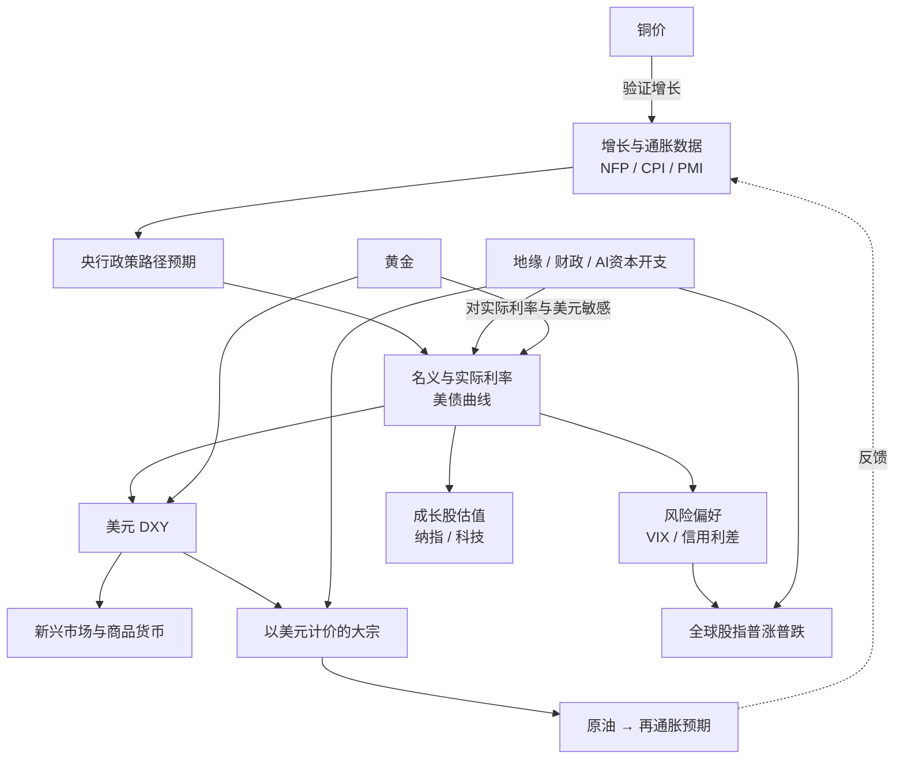

# 全球宏观观察清单与态势读盘框架

> 目的：作为全球金融态势 Dashboard 的观察纲领——顶级投资者应关注哪些指数/商品/个股/数据，为何关注，以及它们之间的因果与相关；并给出从涨跌归纳全球态势与投资意见的方法。  
> 性质：分析框架文档（非个性化投资建议）。  
> 关联：[`financial-market-transmission-chains.md`](./financial-market-transmission-chains.md)（冲击→传导链更底层）；[`macro-rates-data-guide.md`](./macro-rates-data-guide.md)（利率类标的发布源与取数）；本仓库 Dashboard 精选见 `apps/stock-dashboard/src/pages/Dashboard/portal/curatedSymbols.ts`。  
> 日期：2026-11-16

---

## 0. 一句话总览

顶级玩家看的不是「今天谁涨」，而是：

```text
数据（NFP/CPI/PMI）
  → 央行政策路径
  → 利率 / 实际利率 / 美元
  → 风险偏好（VIX / 信用利差）
  → 股 / 商 / 汇 / 金
```

是否闭环；**铜验证增长，油验证通胀冲击，金验证实际利率与避险，VIX+信用验证杠杆是否安全。**

---

## 1. 应关注什么：分层观察清单

顶级投资者很少盯几百个标的，而是盯**因果链上的少数枢纽**。

### 1.1 宏观「因」——利率与流动性（最先看）

| 标的 | 意义 |
|------|------|
| **美联储政策利率预期**（Fed Funds / CME FedWatch） | 全球定价锚：加息/降息预期一变，股债汇商全动 |
| **美债 2年 / 10年 / 30年** | 2Y≈政策路径（权威：`DGS2`）；10Y≈增长+通胀（Yahoo `^TNX` / `DGS10`）；30Y≈财政与期限溢价（`^TYX` / `DGS30`）。注意：本仓库 `^IRX` 是**约 3 月**短端，**不是 2Y** |
| **美债利差 10Y−2Y** | 倒挂/陡峭：衰退预期 vs 再通胀/财政扩张（FRED `T10Y2Y`） |
| **实际利率**（TIPS 实际收益率） | 黄金与成长股估值的真正对手盘（FRED `DFII10`） |
| **美元指数 DXY** | 全球流动性温度计：美元强→新兴市场/大宗承压（Yahoo `DX-Y.NYB`） |

**意义**：利率是资产定价的分母。实际利率↑ → 股估值承压、黄金承压、美元易强。

### 1.2 风险温度计

| 标的 | 意义 |
|------|------|
| **VIX** | 股指恐慌；>25 常伴随去杠杆与抄底博弈 |
| **MOVE**（债市波动） | 债市恐慌往往比 VIX 更早暴露流动性问题 |
| **高收益债利差 HY OAS** | 信用收缩=风险偏好真正恶化，比股市更诚实 |
| **比特币** | 高贝塔流动性探针：风险偏好与流动性松紧的放大器 |

### 1.3 全球股指——「果」与区域分化

| 标的 | 意义 |
|------|------|
| **标普500 / 纳指 / 道指** | 全球风险资产核心；纳指偏成长/科技，道指偏周期/价值 |
| **VIX + 等权 vs 市值加权** | 判断是少数巨头独涨，还是普涨 |
| **欧股（DAX/STOXX50）** | 欧央行政策 + 能源敏感 |
| **日经** | 日央行正常化、日元套利交易敏感 |
| **恒生 / 韩国综指** | 中国增长预期 + 全球半导体/出口链 |
| **A股：沪深300 / 创业板 / 科创50** | 国内政策与风险偏好；与美股相关但常不同步 |

### 1.4 大宗商品——增长与通胀的「体温计」

| 标的 | 意义 |
|------|------|
| **铜** | 「博士铜」：全球工业与电力/数据中心需求领先指标 |
| **原油 WTI/布伦特** | 地缘+供需；短期推通胀预期，中期影响实际收入 |
| **黄金** | 实际利率↓、美元↓、央行购金、地缘避险 → 金价↑ |
| **白银** | 金银比：工业属性更强，风险偏好回暖时常跑赢金 |
| **天然气** | 欧亚能源冲击与通胀脉冲 |
| **螺纹/橡胶/豆粕**（国内） | 中国地产与内需温度 |

### 1.5 外汇——资本流动方向

| 标的 | 意义 |
|------|------|
| **EURUSD / USDJPY / AUDUSD** | 欧日政策差；澳元=商品货币≈风险偏好 |
| **USDCNY / USDHKD** | 中国资本流动与联系汇率压力 |

### 1.6 单票 / 板块（只盯「系统重要性」少数）

不必盯很多个股，盯**叙事枢纽**：

| 标的/板块 | 意义 |
|-----------|------|
| **NVDA / 半导体（SOX）** | AI 资本开支与盈利兑现；估值与叙事锚之一 |
| **大型科技（Magnificent 权重）** | 决定标普能否独立于广度走强 |
| **银行指数（如 KBE/XLF）** | 利率曲线陡峭+信贷质量 |
| **能源股 vs 油价** | 验证油价是需求驱动还是供给冲击 |
| **中国：茅指数/宁组合/券商** | 消费、成长、风险偏好三探针 |

### 1.7 经济数据日历（真正的「因」事件）

| 数据 | 意义 |
|------|------|
| **非农 NFP + 失业率 + 薪资** | 就业强→联储难松；弱→衰退定价 |
| **CPI / PCE（核心）** | 通胀粘性直接改写利率路径 |
| **ISM/PMI（制造+服务）** | 景气拐点，早于财报 |
| **初请失业金** | 周度高频就业 |
| **零售销售 / 消费者信心** | 需求韧性 |
| **中国：社融、PMI、进出口** | 全球商品与新兴市场β |
| **欧央行/日央行决议** | 与美联储的政策差 → 汇率与跨市场套利 |

---

## 2. 因果与相关性：谁是因，谁是果

金融里很少有绝对因果，更多是**高概率传导链**（可被冲击打断）。



### 2.1 常见相关规则（实务版）

1. **利率是因，估值是果**  
   实际利率↑ → 纳指/金币承压；利率↓ → 两者受益（前提：不是衰退式下跌）。

2. **美元是全球紧缩通道**  
   美元↑ → 新兴股市/商品/黄金承压；美元↓ → 风险资产与金铜易涨。

3. **铜看增长，油看通胀+地缘**  
   - 铜↑油平：偏「良性扩张」  
   - 油↑铜↓：偏「滞胀/供给冲击」——对股债都难受  
   - 铜油齐跌：偏「需求衰退」

4. **股债同跌 = 危险信号**  
   股↓ + 债↓（收益率↑）→ 流动性/通胀冲击；  
   股↓ + 债↑（收益率↓）→ 典型避险，衰退交易。

5. **VIX↑ + HY利差↑** 才是真风险关闭；仅 VIX 脉冲而信用稳，多为短震。

6. **黄金与实际利率大致负相关，与美元大致负相关**；若利率↑金仍涨，往往在定价地缘或央行购金等「非利率因素」。

7. **日元与套利交易**：日央行意外收紧 → 平仓潮 → 全球高估值资产共振下跌（日经先动，纳指随后）。

8. **A股与美股**：同向时看全球β；背离时看国内政策/流动性——此时沪深300与北向、社融比盯标普更重要。

---

## 3. 如何从涨跌总结「全球态势」与投资意见

### 3.1 读盘四步法（每天/每周可复用）

| 步骤 | 看什么 | 问什么 |
|------|--------|--------|
| 1. 体制 | 2Y、10Y、DXY、实际利率 | 偏宽松 / 紧缩 / 滞胀 / 衰退？ |
| 2. 风险闸门 | VIX、HY利差、BTC | 风险偏好开还是关？ |
| 3. 增长验真 | 铜、顺周期股、PMI、非农 | 增长在加速还是减速？ |
| 4. 叙事一致性 | 纳指 vs 等权、金 vs 实际利率、油 vs 铜 | 价格在讲同一个故事吗？ |

### 3.2 合成口诀

- **金↑ + 美债收益率↓ + 股↓** → 避险/衰退交易  
- **金↓ + 收益率↑ + 美元↑ + 股震荡** → 紧缩/再通胀交易  
- **铜↑ + 股↑ + 美元弱** → 全球复苏/风险开  
- **油↑ + 铜↓ + 股债双杀** → 滞胀威胁，降杠杆优先  

### 3.3 结合 2026 年 11 月前后的公开宏观语境（框架性）

公开机构讨论大致指向同一体制：

- **美国增长仍有韧性，通胀偏粘，联储偏鹰** → 美债收益率与美元易维持偏高水平  
- **油价地缘溢价有所回落** → 有助缓和通胀预期，但路径仍反复  
- **AI/科技仍是盈利与波动双核心** → 指数看似强，内部可能很分化  
- **金仍受央行需求支撑，但受实际利率与美元压制时会回调**  

据此可归纳为一种**「中周期 + 高利率约束」**态势，而非纯粹牛市无脑加仓：

| 维度 | 倾向性意见（框架） |
|------|-------------------|
| 总体仓位 | 保持均衡，避免极端杠杆；用波动率升高时做再平衡，而非追涨杀跌 |
| 权益 | 偏质量与盈利兑现（能把 AI/资本开支变成现金流的标的）；广度差时降低追高单一巨头的权重 |
| 固收 | 关注曲线中段（约 3–7 年）的票息与久期平衡；信用选中高等级，避开最差尾部 |
| 商品 | 铜：中长期电力/数据中心逻辑仍在；油：更宜区间与事件驱动，不宜单边信仰；金：作为对冲配置，而非追动量 |
| 外汇/新兴 | 美元偏强阶段对新兴与商品货币保持克制；美元转弱才系统性加新兴β |
| 中国资产 | 更多跟国内流动性与政策，不全局对标美股；用铜、澳元、韩台半导体做外盘交叉验证 |

**一句话**：当前公开信息更接近 **「高利率约束下的中周期分化市」**——重质量与对冲，轻单边押注。

---

## 4. 对本仓库 Dashboard 的补齐建议

现有精选（`curatedSymbols.ts`）已覆盖：全球股指、美债、外汇、金铜油气、国内期货、加密货币、A股主指数。

**已落地（2026-11-16）**：面板 `macro.rates`（联储目标/EFFR/美债2·10·30Y/利差/实际10Y + FedWatch 外链）、利率条带补 `^FVX`、外汇条带补 `DX-Y.NYB`。详见 [`macro-rates-data-guide.md`](./macro-rates-data-guide.md) §9。

仍可继续补的枢纽：

1. **HY 信用利差 / MOVE**  
2. **SOX 或 NVDA**（AI 叙事锚）  
3. **经济日历条**：NFP、CPI、FOMC、中国 PMI（事件比价格更「因」）

---

## 5. 修订记录

| 日期 | 说明 |
|------|------|
| 2026-11-16 | 初版：观察清单、因果链、读盘四步法、当期体制框架与 Dashboard 补齐建议 |
