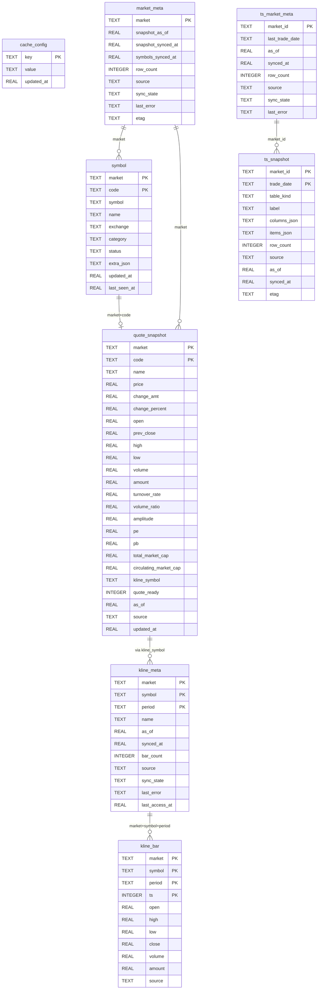
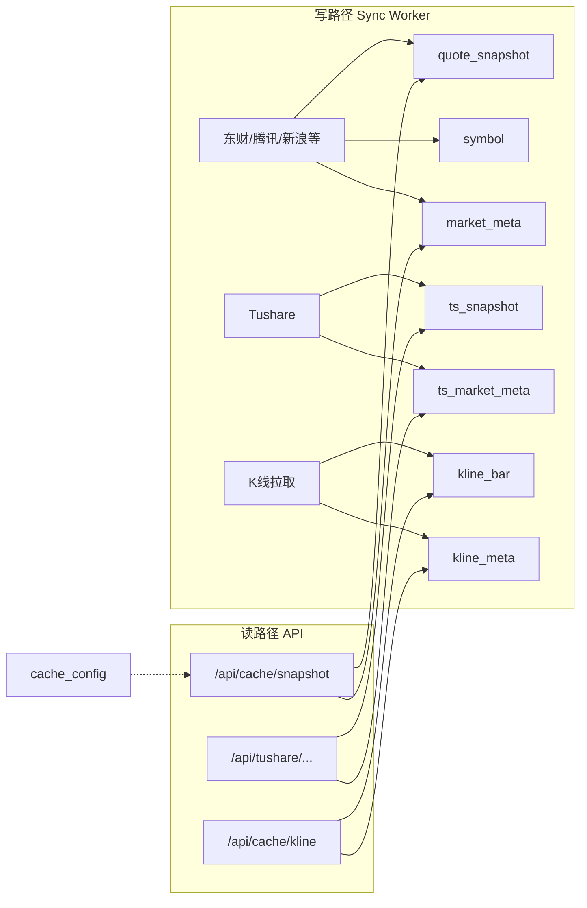

# quote_cache.db 库表设计

> 文件：`data/quote_cache.db`（gitignore，本机生成）  
> Schema 源码：[`web/cache/schema.sql`](../web/cache/schema.sql)  
> 连接：[`web/cache/db.py`](../web/cache/db.py)（WAL、`busy_timeout=5000`）  
> 路径可用环境变量 `QUOTE_CACHE_PATH` 覆盖  

本文描述行情本地缓存库的表结构、字段含义、逻辑关系与用途。权威 DDL 以 `schema.sql` 为准；下文带本机实测行数作体感参考（会随同步变化）。

---

## 1. 库定位

本库服务看板 **行情页**、**K 线缓存**、**Tushare 专题**，不服务 `/dapan` 大盘云图（后者用内存短缓存 + 种子 JSON）。

| 层级 | 内容 | 主表 |
|------|------|------|
| L0 代码表 | 各市场标的名册 | `symbol` |
| L1 行情快照 | 全市场/节点列表行情 | `quote_snapshot` + `market_meta` |
| L3 K 线 | 按需打开过的标的 OHLCV | `kline_bar` + `kline_meta` |
| Tushare 轨 | 按交易日的专题切片 | `ts_snapshot` + `ts_market_meta` |
| 配置 | 模式、调度等 KV | `cache_config` |

时间字段除特别说明外均为 **Unix 秒（REAL）**。

单位契约（与 stock-sdk 一致）：

- 成交额 `amount`：**万元**
- 总/流通市值：`total_market_cap` / `circulating_market_cap`：**亿元**
- 成交量 `volume`：**手**（A 股东财口径）

---

## 2. ERD（逻辑关系）

SQLite **未声明 FOREIGN KEY**（应用层约定关联）；下图为逻辑 ERD。



### 关系说明

| 关系 | 含义 |
|------|------|
| `market_meta` ↔ `symbol` / `quote_snapshot` | 同一 `market` 键（如 `cn`、`yf:METALS`）；meta 记录该市场同步状态与行数 |
| `symbol` ↔ `quote_snapshot` | 逻辑主键 `(market, code)`；代码表可略多于快照（退市/未报价） |
| `quote_snapshot.kline_symbol` → K 线 | 跳转/缓存用统一代码（如 `sh600036`、`usAAPL`）；K 线主键用 `symbol` 字段存该值 |
| `kline_meta` → `kline_bar` | 一组 `(market, symbol, period)` 的元信息 + 多根 bar |
| `ts_market_meta` → `ts_snapshot` | 每个 Tushare 节点最新摘要；按 `trade_date` 存历史切片 |
| `cache_config` | 独立 KV，无外键 |

东财轨（`cn/hk/us/...`）与 Tushare 轨（`ts:*`）**分表**，不混用 `market` 主键空间。

---

## 3. 表清单（本机规模示例）

| 表 | 作用 | 示例行数 |
|----|------|----------|
| `cache_config` | 全局配置 KV | ~6 |
| `market_meta` | 东财/懒加载市场同步元数据 | ~15 |
| `symbol` | L0 代码表 | ~2.5 万 |
| `quote_snapshot` | L1 列表行情 | ~2.5 万 |
| `kline_meta` | 单标的周期同步状态 | ~百级 |
| `kline_bar` | K 线 OHLCV | ~数万～十万 |
| `ts_market_meta` | Tushare 节点摘要 | ~16 |
| `ts_snapshot` | Tushare 按日切片 | ~百级 |

---

## 4. 分表说明

### 4.1 `cache_config`

全局配置。写入：设置页、同步调度、启动 `init_db`。

| 列 | 类型 | 说明 |
|----|------|------|
| `key` | TEXT PK | 配置键 |
| `value` | TEXT | 标量或 JSON 字符串 |
| `updated_at` | REAL | 更新时间 |

常见键：

| key | 含义 |
|-----|------|
| `mode` | 缓存模式：`speed` / `balanced` / `realtime` |
| `quote_source` | 读盘策略相关：如 `network` / `local` / `auto` |
| `prefetch` | 预取策略，如 `symbols+last_market` |
| `last_market` | 最近浏览的市场 id |
| `ts_schedule_last_run` | Tushare 定时任务上次批次标记 |
| `ts_schedule_last_result` | 定时结果 JSON |

---

### 4.2 `market_meta`

东财 / 静态目录 / yfinance 等 **列表市场** 的同步头信息。一行一个 `market`。

| 列 | 类型 | 说明 |
|----|------|------|
| `market` | TEXT PK | 市场 id，见下表 |
| `snapshot_as_of` | REAL | 快照业务时间（源数据时间） |
| `snapshot_synced_at` | REAL | 本机写入完成时间 |
| `symbols_synced_at` | REAL | 代码表同步时间 |
| `row_count` | INTEGER | 快照行数 |
| `source` | TEXT | 如 `eastmoney` / `tencent` / `sina` / `yahoo` / `cache+static` |
| `sync_state` | TEXT | `idle` / `running` / `error` |
| `last_error` | TEXT | 最近错误 |
| `etag` | TEXT | 可选校验标记 |

常见 `market` 值：

| market | 含义 |
|--------|------|
| `cn` / `hk` / `us` | A / 港 / 美全市场列表 |
| `fund` / `index` / `futures` | 基金、指数、期货 |
| `yf:METALS` 等 | yfinance 扩展节点 |

行情页「同步本轨」会更新对应行的 `sync_state` / `source` / `row_count`。

---

### 4.3 `symbol`（L0）

代码名册，支撑搜索、过滤、退市标记；可与快照同步写入或单独维护。

| 列 | 类型 | 说明 |
|----|------|------|
| `market` | TEXT | 市场 |
| `code` | TEXT | 市场内代码（如 `600036`） |
| `symbol` | TEXT | 统一符号（展示/跳转，可含前缀） |
| `name` | TEXT | 名称 |
| `exchange` | TEXT | 交易所（可选） |
| `category` | TEXT | 分类（可选） |
| `status` | TEXT | 默认 `active` |
| `extra_json` | TEXT | 扩展 JSON |
| `updated_at` | REAL | 行更新时间 |
| `last_seen_at` | REAL | 最近在同步中出现的时间 |

主键：`(market, code)`  
索引：`(market, status)`、`(market, name)`

---

### 4.4 `quote_snapshot`（L1）

行情列表主表。`GET /api/cache/snapshot` 主要读此表。

| 列 | 类型 | 说明 |
|----|------|------|
| `market` | TEXT | 市场 |
| `code` | TEXT | 列表代码 |
| `name` | TEXT | 名称 |
| `price` | REAL | 最新价 |
| `change_amt` | REAL | 涨跌额 |
| `change_percent` | REAL | 涨跌幅 % |
| `open` / `prev_close` / `high` / `low` | REAL | OHLC |
| `volume` | REAL | 成交量（手） |
| `amount` | REAL | 成交额（万元） |
| `turnover_rate` | REAL | 换手率 |
| `volume_ratio` | REAL | 量比 |
| `amplitude` | REAL | 振幅 |
| `pe` / `pb` | REAL | 市盈 / 市净 |
| `total_market_cap` | REAL | 总市值（亿元） |
| `circulating_market_cap` | REAL | 流通市值（亿元） |
| `kline_symbol` | TEXT | K 线/跳转代码（如 `sh600036`） |
| `quote_ready` | INTEGER | 1=有有效报价；0=仅名册占位 |
| `as_of` | REAL | 该行行情时间 |
| `source` | TEXT | 行级来源（可与 market_meta 一致或更细） |
| `updated_at` | REAL | 行写入时间 |

主键：`(market, code)`  
索引：`(market, change_percent)`、`(market, total_market_cap)`（排序用）

同步写入：`models.replace_snapshot` / `upsert_snapshot_rows`；A 股源优先级见 [`quotes-market-data-sources.md`](./quotes-market-data-sources.md)。

---

### 4.5 `kline_meta` / `kline_bar`（L3）

按需缓存：用户打开或预热过的标的才有数据，**不是**全市场日 K。

**`kline_meta`** — 某 `(market, symbol, period)` 的同步头：

| 列 | 说明 |
|----|------|
| `market` / `symbol` / `period` | 主键三元组；`period` 如 `1d`/`1m`/`1w` |
| `name` | 标的名 |
| `as_of` / `synced_at` | 数据时间 / 写入时间 |
| `bar_count` | 根数 |
| `source` | 如 `eastmoney` / `sina` / `yahoo` |
| `sync_state` / `last_error` | 状态 |
| `last_access_at` | 最近访问（可做 LRU 清理） |
| `history_exhausted` | 1=已无法向前续拉更早历史（见 [`kline-history-load-more.md`](./kline-history-load-more.md)） |

**`kline_bar`** — 单根 K：

| 列 | 说明 |
|----|------|
| `market` / `symbol` / `period` / `ts` | 主键；`ts` 为 bar 时间戳（整数，秒或毫秒依写入约定） |
| `open`/`high`/`low`/`close` | 价格 |
| `volume` / `amount` | 量额 |
| `source` | 来源 |

索引：`idx_kline_lookup (market, symbol, period, ts)`  
API：`GET /api/cache/kline`；实现见 `kline_models.py` / `kline_fetch.py`。

注意：此处 `symbol` 存的是规范化后的库内码（与 `quote_snapshot.kline_symbol` 对齐），**不是**纯 6 位 `code`。

---

### 4.6 `ts_market_meta` / `ts_snapshot`（Tushare 轨）

与东财 `market` 空间隔离，主键用 `market_id`（如 `ts:limit`、`ts:moneyflow`）。

**`ts_market_meta`** — 节点最新状态：

| 列 | 说明 |
|----|------|
| `market_id` | PK，专题 id |
| `last_trade_date` | 最近交易日 `YYYYMMDD` |
| `as_of` / `synced_at` | 时间 |
| `row_count` | 最近切片行数 |
| `source` | 如 `primary`（主备 Tushare 网关） |
| `sync_state` / `last_error` | 状态 |

**`ts_snapshot`** — 按交易日整包 JSON（适合专题宽表，不必拆列）：

| 列 | 说明 |
|----|------|
| `market_id` + `trade_date` | 复合主键 |
| `table_kind` | 如 `topic` / `quote` |
| `label` | 展示名 |
| `columns_json` | 列定义 JSON 数组 |
| `items_json` | 行数据 JSON 数组 |
| `row_count` | 行数 |
| `source` / `as_of` / `synced_at` / `etag` | 来源与校验 |

索引：`(market_id, synced_at)`  
设计补充见 [`tushare-local-cache.md`](./tushare-local-cache.md)。

---

## 5. 数据流（读写）



---

## 6. 运维速查

```bash
# 打开
sqlite3 data/quote_cache.db

# 表与行数
.tables
SELECT market, row_count, source, sync_state FROM market_meta;
SELECT market_id, last_trade_date, row_count, sync_state FROM ts_market_meta;

# A 股快照抽样
SELECT code, name, price, change_percent, source
FROM quote_snapshot WHERE market='cn' ORDER BY change_percent DESC LIMIT 10;
```

注意：WAL 模式下服务运行时还有 `-wal` / `-shm`；GUI 工具建议在无写入或停服务时打开，避免锁冲突。

---

## 7. 相关文档

| 文档 | 内容 |
|------|------|
| [`local-quote-cache.md`](./local-quote-cache.md) | 缓存架构、模式、TTL |
| [`quotes-market-data-sources.md`](./quotes-market-data-sources.md) | 行情页各市场远程数据源 |
| [`kline-history-load-more.md`](./kline-history-load-more.md) | 日 K 缩放触底向前续拉 |
| [`tushare-local-cache.md`](./tushare-local-cache.md) | Tushare 轨设计 |
| [`background-sync-ux.md`](./background-sync-ux.md) | 后台同步 UX |
